# Cartographie et Index de la Documentation — Atlas Voyage

> **Objet :** Portail d'accès unique et index de l'ensemble de la documentation technique, métier et opérationnelle du projet Atlas Voyage.  
> **Public visé :** Nouveaux développeurs, contributeurs, exploitants, utilisateurs par rôle et auditeurs sécurité.  
> **Dernière mise à jour :** 1er novembre 2026 | **Version de référence :** 3.0 (Phase 14 & Phase 15)  
> **Statut :** ✅ Stable | **Propriétaire :** Équipe d'Ingénierie Atlas Voyage

---

## 1. Comment naviguer dans cette documentation ?

Atlas Voyage applique les principes du **Docs-as-Code** : la documentation vit aux côtés du code source, est versionnée dans Git et s'appuie sur des formats ouverts et vérifiables (Markdown GitHub-Flavored, diagrammes Mermaid, spécifications OpenAPI, collections Postman).

### Parcours par profil

```mermaid
flowchart TD
    Start([Vous êtes...]) --> Dev[Nouveau Développeur]
    Start --> Contrib[Contributeur]
    Start --> Ops[Ingénieur DevOps / Exploitant]
    Start --> User[Utilisateur Métier / Client]
    Start --> Sec[Auditeur Sécurité / RSSI]

    Dev --> R1[README.md racine<br/>Démarrage < 10 min]
    Dev --> R2[docs/architecture.md<br/>C4, ER & Principes]
    Dev --> R3[docs/api/guide_api.md<br/>Guide d'usage API]

    Contrib --> C1[CONTRIBUTING.md<br/>Workflow & Conventions]
    Contrib --> C2[docs/conventions_documentation.md<br/>DoD documentaire]
    Contrib --> C3[CHANGELOG.md<br/>Historique SemVer]

    Ops --> O1[docs/exploitation/README.md<br/>Guide Exploitation]
    Ops --> O2[docs/exploitation/configuration.md<br/>Variables d'env]
    Ops --> O3[docs/exploitation/runbooks.md<br/>Fiches d'incidents]

    User --> U1[docs/manuel/README.md<br/>Manuels par rôle]
    User --> U2[docs/regles_metier.md<br/>Règles & Politiques]

    Sec --> S1[docs/securite/matrice_autorisations.md<br/>Matrice RBAC]
    Sec --> S2[SECURITY.md<br/>Politique de divulgation]
    Sec --> S3[docs/securite/modele_menaces_stride.md<br/>Menaces STRIDE]
```

---

## 2. Index Thématique Détaillé

### 2.1 Prise en main et Référence Générale
- **[`README.md`](../README.md)** : Point d'entrée principal du projet, présentation, installation pas à pas en moins de 10 minutes, prérequis, commandes essentielles et dépannage rapide.
- **[`docs/ETAT_COMPLET_PROJET.md`](ETAT_COMPLET_PROJET.md)** : État réel constaté du projet, inventaire fonctionnel détaillé, historique chronologique des phases 1 à 14 et fonctionnalités prévues.
- **[`docs/conventions_documentation.md`](conventions_documentation.md)** : Guide de contribution documentaire, en-têtes obligatoires, conventions Mermaid et Definition of Done.
- **[`docs/decisions_a_prendre.md`](decisions_a_prendre.md)** : Liste des arbitrages légaux et métier réservés au propriétaire du produit (licence, contacts, délais).

### 2.2 Architecture et Modèle de Données
- **[`docs/architecture.md`](architecture.md)** : Schémas C4 (Contexte, Conteneurs, Composants), diagramme Entité-Relation (ER) des 40 entités JPA, dictionnaire de données complet, diagrammes de séquence et d'états.
- **[`docs/adr/`](adr/)** : Registre des Décisions d'Architecture (MADR) :
  - [`0001`](adr/0001-single-table-inheritance-offres.md) : Héritage `SINGLE_TABLE` pour les offres touristiques.
  - [`0002`](adr/0002-disponibilites-par-periodes-vs-stock.md) : Disponibilités par périodes et capacités exclusives.
  - [`0003`](adr/0003-fournisseurs-specialises-par-categorie.md) : Spécialisation stricte des fournisseurs par domaine d'activité.
  - [`0004`](adr/0004-dirham-marocain-reference-devises-indicatives.md) : Intégrité financière en MAD et devises indicatives.
  - [`0005`](adr/0005-authentification-jwt-cookies-httponly-rotation-refresh.md) : Double protection JWT, cookies HttpOnly, rotation et CSRF.
  - [`0006`](adr/0006-flyway-et-migrations-sql-idempotentes.md) : Gestion des migrations de base de données.
  - [`0007`](adr/0007-geocodage-resilient-open-meteo.md) : Résilience du géocodage mondial sans clé API payante.
  - [`0008`](adr/0008-catalogue-public-unique.md) : Catalogue unique partagé entre invités et clients.
  - [`0009`](adr/0009-i18n-runtime-vanilla-vs-build-time.md) : Moteur d'internationalisation runtime sans étape de build.
  - [`0010`](adr/0010-cache-caffeine-mono-instance.md) : Mise en cache locale Caffeine pour les statistiques et les taux.

### 2.3 API REST et Contrats d'Échange
- **[`docs/api/openapi.yaml`](api/openapi.yaml)** : Spécification OpenAPI 3.0 canonique couvrant l'intégralité des 126 endpoints réels du backend.
- **[`docs/api/guide_api.md`](api/guide_api.md)** : Guide d'utilisation de l'API REST, protocoles d'authentification, conventions JSON, pagination et exemples `curl`.
- **[`docs/api/codes_erreur.md`](api/codes_erreur.md)** : Catalogue exhaustif des codes d'erreurs métier et correspondances HTTP.
- **[`docs/api_endpoints.md`](api_endpoints.md)** : Tableau de synthèse exhaustif des endpoints classés par domaine fonctionnel.
- **[`docs/postman/`](postman/)** : Collection Postman v2.1 avec tests automatisés, scripts de pré-requête et environnements `dev` et `prod`.

### 2.4 Règles Métier et Domaine
- **[`docs/regles_metier.md`](regles_metier.md)** : Règles de gestion, statuts et transitions des réservations, politiques d'annulation et de remboursement, contraintes de capacité, codes promotionnels, rôles et glossaire métier.

### 2.5 Guide d'Exploitation et Production
- **[`docs/exploitation/`](exploitation/)** :
  - [`README.md`](exploitation/README.md) : Vue d'ensemble opérationnelle et rôles d'exploitation.
  - [`configuration.md`](exploitation/configuration.md) : Répertoire complet des propriétés et variables d'environnement.
  - [`deploiement.md`](exploitation/deploiement.md) : Procédures de déploiement pas à pas, migrations et checklist de mise en production.
  - [`sauvegarde_restauration.md`](exploitation/sauvegarde_restauration.md) : Stratégie de sauvegarde, commandes de restauration et RPO/RTO.
  - [`supervision.md`](exploitation/supervision.md) : Endpoints Actuator, journaux d'application, indicateurs clés et seuils d'alerte.
  - [`runbooks.md`](exploitation/runbooks.md) : Fiches réflexes de résolution d'incidents d'exploitation.
  - [`maintenance.md`](exploitation/maintenance.md) : Calendrier des opérations courantes et purges RGPD.

### 2.6 Manuels d'Utilisation par Rôle
- **[`docs/manuel/`](manuel/)** :
  - [`invite.md`](manuel/invite.md) : Visiteur non connecté (recherche, consultation, panier local, création de compte).
  - [`client.md`](manuel/client.md) : Voyageur client (réservation, paiement, suivi, avis, tickets, favoris, profil).
  - [`fournisseur.md`](manuel/fournisseur.md) : Prestataire partenaire (création d'offres en 4 étapes par spécialité, calendrier de capacité).
  - [`agent.md`](manuel/agent.md) : Agent d'agence (gestion des bundles, encaissement espèces, traitement des tickets).
  - [`admin.md`](manuel/admin.md) : Administrateur système (utilisateurs, modération des offres et avis, paramètres, audit, KPIs).

### 2.7 Documentation Transverse Spécialisée
- **Sécurité :** [`docs/securite/`](securite/) (matrice d'autorisations RBAC, modèle de menaces STRIDE, configuration Nginx, procédure de rotation des secrets).
- **Internationalisation :** [`docs/i18n/`](i18n/) (guide d'architecture i18n, guide RTL, gestion des devises indicatives, glossaire trilingue FR/EN/AR).
- **Design & Accessibilité :** [`docs/design/`](design/) (guide des composants `av-*`, charte graphique, palette, audit axe-core 100% WCAG 2.1 AA).

---

## 3. Maintenance et Outillage de la Documentation

La documentation dispose d'une suite de scripts automatisés logés dans [`scripts/docs/`](../scripts/docs/) :

| Commande | Rôle |
| :--- | :--- |
| `npm run docs:gen` | Régénère l'OpenAPI, le dictionnaire de données, les schémas ER et les tableaux de variables. |
| `npm run docs:check` | Vérifie l'absence de liens cassés, le rendu Mermaid, la parité des endpoints et l'absence de secrets. |
| `npm run docs:screenshots` | Capture de façon déterministe les interfaces de chaque rôle avec Chrome Headless. |

