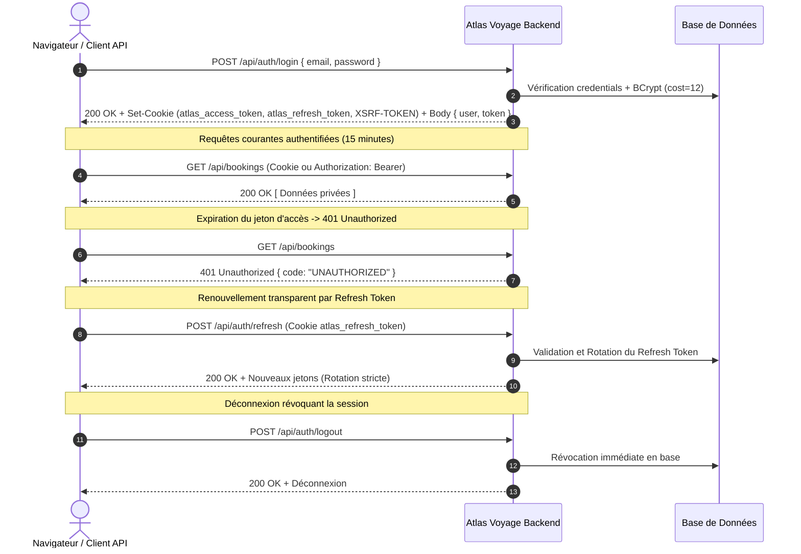

# Guide d'Utilisation de l'API REST — Atlas Voyage

> **Objet :** Manuel d'intégration et de consommation de l'API REST pour les développeurs et partenaires tiers.  
> **Public visé :** Développeurs frontend, intégrateurs backend, partenaires commerciaux et testeurs QA.  
> **Dernière mise à jour :** 1er novembre 2026 | **Version de référence :** 3.0.0  
> **Statut :** ✅ Stable | **Propriétaire :** Équipe d'Ingénierie API

---

## 1. Vue d'Ensemble et URLs de Base

L'API Atlas Voyage est une API RESTful respectant les standards HTTP/1.1 et HTTP/2. Toutes les communications s'effectuent au format **JSON**, encodé en **UTF-8**.

| Environnement | URL de Base | Accès Swagger UI | Documentation OpenAPI |
| :--- | :--- | :--- | :--- |
| **Développement Local** | `http://localhost:8080` | `http://localhost:8080/swagger-ui.html` | `http://localhost:8080/v3/api-docs` |
| **Préproduction / Staging** | `https://api.example.ma` | Protégé par Basic Auth | `https://api.example.ma/v3/api-docs` |
| **Production** | `https://api.atlasvoyage.ma` | Désactivé | Privé (sur demande autorisée) |

---

## 2. Principes Financiers & Règles d'Échange

> ⚠️ **Règle d'or financière absolue :**
> Tous les prix affichés en base, les paniers, les factures et les transactions réelles sont **strictement calculés et débités en Dirhams Marocains (MAD TTC)**.
> Aucune transaction financière réelle n'est autorisée en devises étrangères.
> Les devises `EUR`, `USD`, `GBP` renvoyées par `/api/currencies/rates` sont fournies à titre **purement indicatif**.

---

## 3. Protocole d'Authentification & Sessions

L'API supporte deux mécanismes d'authentification compatibles :
1. **Cookies HTTP Sécurisés (Recommandé pour navigateurs) :**
   - Cookie d'accès : `atlas_access_token` (`HttpOnly`, `SameSite=Lax`, `Path=/`, durée : 15 min).
   - Cookie de rafraîchissement : `atlas_refresh_token` (`HttpOnly`, `SameSite=Lax`, `Path=/api/auth/refresh`, durée : 7 jours).
   - Cookie CSRF : `XSRF-TOKEN` (lisible par le client, à renvoyer dans l'en-tête `X-XSRF-TOKEN`).
2. **Jeton Bearer Authorization (Recommandé pour scripts / Postman / serveurs) :**
   - En-tête : `Authorization: Bearer <access_token>`.

### Flux d'authentification complet



---

## 4. Conventions d'Échange

- **Formats de date et heure :** Toutes les dates sont au format **ISO-8601 UTC** (`YYYY-MM-DDTHH:mm:ssZ`).
- **Précision monétaire :** Les montants monétaires sont des nombres décimaux à deux chiffres après la virgule (`BigDecimal`), toujours en MAD (ex: `1250.00`).
- **Pagination standard :**
  - Paramètres de requête : `page` (base 0, défaut 0), `size` (défaut 20, plafond strict à 100).
  - Format de réponse standardisé :
    ```json
    {
      "content": [ ... ],
      "page": 0,
      "size": 20,
      "totalElements": 48,
      "totalPages": 3,
      "last": false
    }
    ```
- **Tri sécurisé :** Seuls les champs explicitement autorisés par contrôleur peuvent être passés en paramètre `sort` (ex : `sort=createdAt,desc`). Tout tri non autorisé est rejeté avec un code `400 BAD_REQUEST`.
- **En-têtes recommandés :**
  - `Accept-Language: fr` (ou `en`, `ar`) pour recevoir les messages d'erreur et données localisées.
  - `X-Request-Id: <UUID>` pour assurer la traçabilité complète des requêtes dans les journaux d'audit.

---

## 5. Limitation de Débit (Rate Limiting)

L'API est protégée par un filtre d'étranglement par seau à jetons (Bucket4j) basé sur l'adresse IP et l'identité :
- **Endpoints d'authentification (`/api/auth/*`) :** Limité à **5 requêtes par minute** par adresse IP.
- **Endpoints généraux de l'API :** Limité à **100 requêtes par minute** par client.

En cas de dépassement, l'API répond immédiatement avec le code HTTP **`429 Too Many Requests`** accompagné de l'en-tête de repli :
```http
HTTP/1.1 429 Too Many Requests
Content-Type: application/json
Retry-After: 45

{
  "timestamp": "2026-11-01T22:00:00Z",
  "status": 429,
  "code": "RATE_LIMIT_EXCEEDED",
  "message": "Trop de requêtes effectuées. Veuillez patienter 45 secondes avant de réessayer.",
  "requestId": "req-987654321"
}
```

---

## 6. Exemples `curl` Testés sur les Parcours Clés

### 6.1 Consulter la santé de l'API
```bash
curl -s -X GET "http://localhost:8080/api/status" \
  -H "Accept: application/json"
```
*Réponse attendue (200 OK) :*
```json
{
  "status": "UP",
  "version": "3.0.0",
  "timestamp": "2026-11-01T22:00:00Z"
}
```

### 6.2 Authentification Voyageur Client (Dev)
```bash
curl -s -X POST "http://localhost:8080/api/auth/login" \
  -H "Content-Type: application/json" \
  -d '{
    "email": "sarah.benali@example.com",
    "password": "password123"
  }'
```
*Réponse attendue (200 OK) :*
```json
{
  "token": "eyJhbGciOiJIUzI1NiJ9...",
  "user": {
    "id": 3,
    "email": "sarah.benali@example.com",
    "fullName": "Sarah Benali",
    "role": "CLIENT",
    "preferredLanguage": "fr",
    "preferredCurrency": "MAD"
  }
}
```

### 6.3 Rechercher des Offres Disponibles
```bash
curl -s -X GET "http://localhost:8080/api/offers/search?type=HOTEL&cityName=Marrakech&page=0&size=5" \
  -H "Accept-Language: fr"
```

### 6.4 Obtenir les Taux de Change Indicatifs
```bash
curl -s -X GET "http://localhost:8080/api/currencies/rates"
```
*Réponse attendue (200 OK) :*
```json
{
  "baseCurrency": "MAD",
  "rates": {
    "MAD": 1.0,
    "EUR": 0.092,
    "USD": 0.100,
    "GBP": 0.078
  },
  "updatedAt": "2026-11-01T20:00:00Z",
  "disclaimer": "Toutes les transactions s'effectuent obligatoirement en Dirhams Marocains (MAD). Les devises étrangères sont fournies à titre indicatif."
}
```

### 6.5 Déposer un Message de Contact (Avec Honeypot)
```bash
curl -s -X POST "http://localhost:8080/api/contact" \
  -H "Content-Type: application/json" \
  -d '{
    "name": "Jean Dupont",
    "email": "jean.dupont@example.com",
    "subject": "Renseignements sur circuit désert",
    "message": "Bonjour, proposez-vous des guides francophones pour le bivouac à Merzouga ?",
    "_hp": ""
  }'
```

