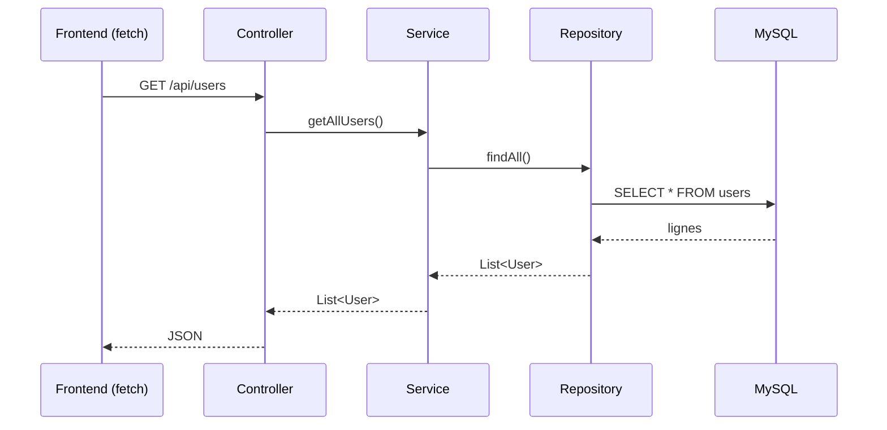
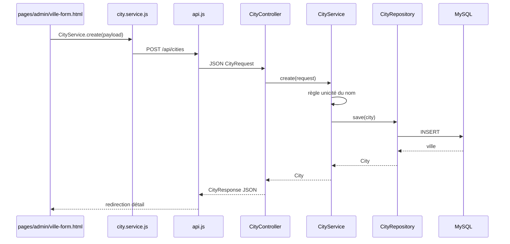
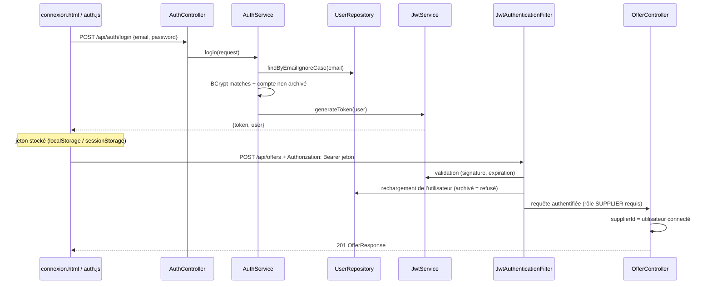

# Architecture du Projet "Atlas Voyage"

Ce document décrit l'architecture technique, la stack et le modèle de données de l'application web de l'agence de voyage "Atlas Voyage".

## Diagramme Général de l'Architecture

```mermaid
flowchart TD
    subgraph Client [Frontend (Navigateur)]
        UI[Pages HTML / CSS]
        JS[Logique Client - fetch API]
        UI <--> JS
    end

    subgraph Serveur [Backend (Spring Boot sur port 8080)]
        API[Controllers REST]
        Service[Services - logique métier]
        Repo[Repositories - accès aux données]
        Entity[Entities JPA]
        API --> Service
        Service --> Repo
        Repo -.->|manipule| Entity
    end

    subgraph Base de Données
        DB[(MySQL - port 3306)]
    end

    JS <-->|Requêtes HTTP JSON| API
    Repo <-->|JPA / Hibernate| DB
```

## 1. Stack Technologique

Le projet suit une architecture découplée (Frontend autonome communiquant avec une API REST Backend). Conformément au cahier des charges, aucun framework Frontend n'est utilisé.

**Frontend (Côté Client) :**
- **HTML5 & CSS3** : Sémantique, Responsive Design (Mobile First).
- **JavaScript (Vanilla)** : Manipulation du DOM, gestion du carrousel, filtres et requêtes API via `fetch()`.

**Backend (Côté Serveur) :**
- **Langage** : Java 21.
- **Framework** : Spring Boot 3.x.
- **Dépendances principales** :
  - *Spring Web* (Création des API REST).
  - *Spring Data JPA* (ORM pour interagir avec la base de données).
  - *Spring Security* + *jjwt* (authentification par jeton JWT, contrôle d'accès par rôle, hachage BCrypt) ; voir « Authentification et sécurité ».
  - *Spring Boot Starter Mail* (envoi d'emails de confirmation) : **prévu, pas encore ajouté** au `pom.xml`.

**Base de données :**
- **SGBD** : MySQL (XAMPP en local). Les tables sont générées par Hibernate (`spring.jpa.hibernate.ddl-auto=update`).

---

## 2. Architecture Logicielle (Backend)

Le Backend Spring Boot est structuré en couches (Layered Architecture), sous le package racine `com.agence.voyage` :

| Package | Rôle | Annotation Spring |
|---|---|---|
| `controller` | Expose les endpoints REST, reçoit les requêtes HTTP, délègue au service. Aucune logique métier. | `@RestController` |
| `service` | Contient la logique métier (validation, règles, calculs). Seule couche qui appelle les repositories. | `@Service` |
| `repository` | Interfaces Spring Data JPA (`JpaRepository`) pour l'accès à la base. | (détecté automatiquement) |
| `entity` | Classes Java mappées sur les tables MySQL (et énumérations associées). | `@Entity` |
| `dto` | Objets de transfert pour les requêtes/réponses API (sans logique métier). | — |
| `exception` | Gestion centralisée des erreurs HTTP (`GlobalExceptionHandler` : `400`, `401`, `403`, `404`). | `@RestControllerAdvice` |
| `security` | Jeton JWT (`JwtService`), filtre d'authentification (`JwtAuthenticationFilter`), adaptation de `User` pour Spring Security (`AppUserDetails`, `AppUserDetailsService`). | `@Service`, `@Component` |
| `config` | Configuration transverse (`SecurityConfig` : règles d'accès et CORS, `PasswordConfig` : encodeur BCrypt, `DataSeeder` : données de démarrage). | `@Configuration`, `@Component` |

### Flux d'une requête : Controller → Service → Repository



Règle de dépendance : `Controller → Service → Repository → Entity`. Une couche ne connaît que celle située juste en dessous ; le Controller n'accède jamais directement au Repository.

### IoC et injection de dépendances

- Les classes annotées `@RestController`, `@Service`, `@Component` sont détectées au démarrage par le *component scan* de `@SpringBootApplication` et instanciées comme **beans** par le **conteneur Spring** (IoC : ce n'est plus le code qui fait `new`, c'est le conteneur).
- Les repositories sont des interfaces : Spring Data génère leur implémentation et l'enregistre comme bean.
- Les dépendances sont injectées **par constructeur** (champs `final`), par exemple :

```java
@RestController
@RequestMapping("/api/users")
public class UserController {
    private final UserService userService;

    public UserController(UserService userService) {   // injecté par Spring
        this.userService = userService;
    }
}
```

### État actuel de l'implémentation

| Composant | Classes |
|---|---|
| Controllers | `UserController`, `StatusController`, `CityController`, `OfferController`, `BundleController`, `AuthController` |
| Services | `UserService`, `CityService`, `OfferService`, `BundleService`, `AuthService` |
| Security | `JwtService`, `JwtAuthenticationFilter`, `AppUserDetails`, `AppUserDetailsService` |
| Repositories | un par entité (`User`, `Offer`, `Bundle`, `Cart`, `CartItem`, `PromoCode`, `Booking`, `Payment`, `Notification`, `City`) |
| DTO | `CityRequest`, `CityResponse`, `UserRequest`, `UserResponse`, `OfferRequest`, `OfferResponse`, `BundleRequest`, `BundleResponse`, `LoginRequest`, `RegisterRequest`, `AuthResponse` |
| Config | `SecurityConfig`, `PasswordConfig`, `DataSeeder` (comptes de test + villes de référence) |

### Séance 2 — Première fonctionnalité métier : **Villes**

**Objectif pédagogique :** architecture en couches, IoC, beans Spring, injection par constructeur, séparation présentation / métier.

**Flux complet (exemple création d'une ville) :**



**Endpoints `/api/cities` :**

| Méthode | Route | Rôle |
|---|---|---|
| GET | `/api/cities` | Liste |
| GET | `/api/cities/{id}` | Détail |
| POST | `/api/cities` | Création |
| PUT | `/api/cities/{id}` | Modification |
| DELETE | `/api/cities/{id}` | Suppression |

**Règles métier (couche `CityService` uniquement) :**
- Nom obligatoire et trim ;
- Unicité du nom (insensible à la casse) ;
- Ville introuvable → `404` ; conflit de nom → `400` ; suppression refusée (`400`) si la ville est utilisée par des offres.

### Module Utilisateurs (Admin) : CRUD + archivage

Même découpage Controller → Service → Repository que les villes. L'entité `User` porte un indicateur `archived` (par défaut `false`).

**Endpoints `/api/users` :**

| Méthode | Route | Rôle |
|---|---|---|
| GET | `/api/users` | Liste (actifs **et** archivés ; le filtrage est fait côté frontend) |
| GET | `/api/users/{id}` | Détail |
| POST | `/api/users` | Création |
| PUT | `/api/users/{id}` | Modification |
| POST | `/api/users/{id}/archive` | Archivage (l'utilisateur disparaît de la liste par défaut) |
| POST | `/api/users/{id}/restore` | Restauration |
| DELETE | `/api/users/{id}` | Suppression définitive (réservée aux comptes archivés) |

**Règles métier (couche `UserService` uniquement) :**
- Nom complet, email (format valide) et rôle obligatoires ; nom et email sont trimés.
- Email unique, insensible à la casse (création et modification) → conflit = `400`.
- Mot de passe obligatoire à la création (8 caractères minimum), haché en **BCrypt** ; en modification, un mot de passe vide laisse le hash inchangé.
- Le mot de passe n'est jamais renvoyé : `UserResponse` ne contient que `id`, `fullName`, `email`, `role`, `archived`.
- Suppression définitive refusée (`400`) si le compte n'est pas archivé, ou s'il est référencé par des offres, paniers ou réservations.
- Utilisateur introuvable → `404`.

**Flux de création :** bouton « Créer un compte » → `openModal("create-user")` → `api.post("/api/users")` → `UserController.create` (`@Valid` sur `UserRequest`) → `UserService.create` → `UserRepository.save` → `UserResponse` (201) → rechargement de la liste (`GET /api/users`).

> Un compte archivé est refusé à la connexion et son jeton est rejeté à chaque requête (voir « Authentification et sécurité »).

### Module Offres (Fournisseur) : CRUD des 5 types

Une seule ressource `/api/offers` couvre les cinq sous-classes de `Offer` (héritage `SINGLE_TABLE`). Le champ `type` (`FLIGHT`, `HOTEL`, `CAR`, `TAXI_TRANSFER`, `EXCURSION`, énumération `OfferType`) choisit la sous-classe ; `OfferRequest` / `OfferResponse` portent les champs communs et ceux de chaque sous-type (les champs non concernés valent `null`).

**Endpoints `/api/offers` :**

| Méthode | Route | Rôle |
|---|---|---|
| GET | `/api/offers` | Liste ; filtres facultatifs `?supplierId=` et `?type=` |
| GET | `/api/offers/{id}` | Détail |
| POST | `/api/offers` | Création (`201`) |
| PUT | `/api/offers/{id}` | Modification (le type ne peut pas changer) |
| DELETE | `/api/offers/{id}` | Suppression (`204`) |

**Règles métier (couche `OfferService` uniquement) :**
- Champs communs : titre, prix de base (≥ 0), stock (≥ 0), ville et fournisseur obligatoires ; 5 images (URL) au maximum ; offre active par défaut (`active`).
- Le fournisseur doit exister, avoir le rôle `SUPPLIER` et ne pas être archivé ; la ville doit exister (`404` sinon).
- Vol : compagnie, aéroports de départ et d'arrivée obligatoires, arrivée postérieure au départ.
- Hôtel : 1 à 5 étoiles et type de chambre obligatoires. Voiture : marque obligatoire, places ≥ 1. Taxi : lieux de prise en charge et de dépose obligatoires. Excursion : durée ≥ 1 heure.
- Suppression refusée (`400`) si l'offre est référencée par un panier, un bundle ou une réservation : le fournisseur la désactive à la place.
- Propriété : le fournisseur d'une offre est toujours l'utilisateur authentifié (le `supplierId` du corps est ignoré) ; modifier ou supprimer l'offre d'un autre fournisseur renvoie `403`.

### Module Bundles (Agent) : composition d'offres

Un bundle regroupe au moins deux offres de fournisseurs (relation `@ManyToMany` via la table `bundle_offers`) et appartient à l'agent qui l'a créé (`@ManyToOne`).

**Endpoints `/api/bundles` :**

| Méthode | Route | Rôle |
|---|---|---|
| GET | `/api/bundles` | Liste ; filtre facultatif `?agentId=` |
| GET | `/api/bundles/{id}` | Détail |
| POST | `/api/bundles` | Création (`201`) |
| PUT | `/api/bundles/{id}` | Modification (titre, description, remise, offres) |
| DELETE | `/api/bundles/{id}` | Suppression (`204`) |

**Valeurs calculées (`BundleResponse`) :** `sumPrice` (somme des prix de base), `finalPrice` (somme moins la remise en %), `stock` (stock le plus bas parmi les offres, §5.3), `limitingOfferTitle` (offre qui limite le stock) et `cities`.

**Règles métier (couche `BundleService`) :**
- Titre obligatoire ; remise comprise entre 0 et 100 % ; au moins 2 offres distinctes et existantes (`404` sinon).
- Le créateur est toujours l'agent authentifié (le `createdById` du corps est ignoré) ; modifier ou supprimer le bundle d'un autre agent renvoie `403`.
- Une offre utilisée dans un bundle ne peut pas être supprimée (elle se désactive) ; la suppression d'un bundle ne touche pas à ses offres, et est refusée s'il figure dans un panier ou une réservation.

### Authentification et sécurité (Spring Security + JWT)

L'API est **sans état** : pas de session serveur, chaque requête protégée porte son jeton JWT (`Authorization: Bearer …`). Le détail des routes et des droits est dans [`api_endpoints.md`](api_endpoints.md#authentification-et-droits-daccès).



**Composants** (package `security` et `config`) :

| Classe | Rôle |
|---|---|
| `SecurityConfig` | Sessions `STATELESS`, CSRF désactivé (pas de cookie), CORS, règles d'accès par route et par rôle, réponses `401` / `403` en JSON |
| `JwtService` | Génère et valide le jeton (HMAC, expiration 24 h, claims `userId` et `role`) |
| `JwtAuthenticationFilter` | Lit l'en-tête `Bearer`, valide le jeton et **recharge l'utilisateur en base** à chaque requête |
| `AppUserDetails` / `AppUserDetailsService` | Adaptent l'entité `User` ; un compte archivé est « désactivé » |
| `PasswordConfig` | Bean `PasswordEncoder` (BCrypt) partagé par `UserService`, `AuthService` et `DataSeeder` |

**Règles clés :**
- Inscription publique : le rôle est **toujours `CLIENT`** (un `role` envoyé est ignoré) ; les autres rôles sont créés par un administrateur.
- Mêmes message et code (`401`) pour un email inconnu et un mauvais mot de passe : pas de fuite d'information sur l'existence d'un compte.
- Le rôle ne suffit pas : fournisseur et créateur d'un bundle sont pris **dans le jeton**, et les contrôleurs d'offres et de bundles vérifient la propriété (`403` sinon, via `ForbiddenException`).
- Le catalogue (`GET` offres, villes, bundles) reste public pour la page d'accueil, le catalogue et la carte.
- La clé `jwt.secret` est dans `application.properties` (valeur de développement local, à remplacer hors de cet environnement).

---

## 2 bis. Architecture Frontend (Séance 2)

Le module **Villes** illustre la séparation des responsabilités côté client :

| Dossier / fichier | Rôle |
|---|---|
| `pages/admin/villes.html` | Page liste (HTML + chargement scripts) |
| `pages/admin/ville-form.html` | Formulaire ajout / modification |
| `pages/admin/ville-detail.html` | Page détail |
| `js/core/config.js` | Configuration (URL API) |
| `js/core/api.js` | Couche HTTP (`fetch`) — ajoute le jeton JWT ; un `401` ramène à la connexion |
| `js/core/auth.js` | Session : jeton, utilisateur connecté, `login` / `register` / `logout`, garde par rôle `requireRole()` |
| `connexion.html`, `css/connexion.css`, `js/pages/connexion.page.js` | **Écran unique** de connexion et d'inscription ; redirige vers l'espace correspondant au rôle |
| `js/services/city.service.js` | Appels API du domaine « Ville » |
| `js/pages/*.page.js` | Logique de présentation par page |
| `js/components/admin-layout.js` | Layout admin réutilisable |
| `css/pages/villes.css` | Styles du module Villes |

Le catalogue public (`js/app.js`) reste séparé : il ne contient pas la logique CRUD des villes.

**Espaces professionnels (maquettes intégrées) :**

| Espace | Entrée | Scripts | API branchée |
|---|---|---|---|
| Administration | `admin/index.html` | `admin/js/app.js`, `js/core/api.js` | Utilisateurs (CRUD + archivage, filtres rôle/statut), Villes (liste/suppression) |
| Agent | `agent/index.html` | `agent/js/app.js`, `js/core/api.js` | Bundles (liste avec recherche, création/modification avec sélecteur d'offres, suppression) ; réservations, paiements, tickets en données démo |
| Fournisseur | `supplier/index.html` | `supplier/js/app.js`, `js/core/api.js` | Offres (liste avec boutons d'action, création/modification en 4 étapes pour les 5 types, activation, suppression), Inventaire (niveau de stock, stock modifiable dans le tableau avec enregistrement automatique), Villes (select du formulaire) |
| Client (SPA) | `client/index.html` | `client/js/app.js` | Données démo (le nom affiché est celui du compte connecté) ; **accueil public** : `accueil.html` |

**Accès aux espaces :** chaque espace appelle `Auth.requireRole("<RÔLE>")` dès le chargement de la page. Sans session, ou avec un autre rôle, le navigateur est redirigé vers `connexion.html` (avec un message si le rôle ne convient pas). La page de connexion renvoie ensuite vers l'espace du rôle (`ADMIN` → `admin/`, `SUPPLIER` → `supplier/`, `AGENT` → `agent/`, `CLIENT` → `client/`). Le bouton « Déconnexion » de chaque espace efface la session ; l'en-tête des pages publiques affiche « Se connecter », ou le lien vers l'espace du rôle et « Déconnexion ».

Navigation interne : paramètre d’URL `?page=` (ex. `client/index.html?page=reservations`, `supplier/index.html?page=offers`). Le tableau de bord, les réservations et les notifications fournisseur restent en **données démo** jusqu’à l’API métier. Les menus latéraux des espaces Administration, Fournisseur, Agent et Client sont repliables (bouton ☰, barre réduite aux icônes).

---

## 3. Modèle de Données (package `entity`)

Toutes les entités sont créées ; voir le cahier des charges (§6) pour le détail des champs.

- **`User`** : `id`, `fullName`, `email` (unique), `password`, `role`. Rôles (`Role`) : `CLIENT`, `SUPPLIER`, `AGENT`, `ADMIN`.
- **`Offer`** (classe abstraite, héritage `SINGLE_TABLE`, discriminant `offer_type`) : `title`, `description`, `basePrice`, `stock`, `allowsPayOnArrival`, `images`, `city`, `supplier`. Sous-classes : `Flight`, `Hotel`, `Car`, `TaxiTransfer`, `Excursion`.
- **`City`** : référentiel géographique (nom, latitude, longitude) ; une offre est rattachée à une ville.
- **`Bundle`** : offre composée de plusieurs offres, créée par un agent.
- **`Cart`** / **`CartItem`** : panier du client et ses lignes.
- **`PromoCode`** : code de réduction (`DiscountType`).
- **`Booking`** : réservation (`BookingStatus`).
- **`Payment`** : paiement (`PaymentMethod`, `PaymentStatus`).
- **`Notification`** : notifications in-app.

---

## 4. Communication Frontend <-> Backend

Le Frontend appelle l'API REST Spring Boot (port `8080`) avec `fetch()` ; le CORS est configuré dans `SecurityConfig`, et les requêtes protégées portent le jeton JWT. Le Frontend ne contient que la présentation et l'appel à l'API ; toute la logique métier reste dans les services du Backend.

**Endpoints existants** (liste complète et détail des champs : [`api_endpoints.md`](api_endpoints.md)) :
- `GET /api/status` : vérifie la connexion Frontend/Backend.
- `/api/auth` : `register`, `login`, `me` ; voir « Authentification et sécurité ».
- `/api/users` : CRUD + archivage/restauration des utilisateurs (espace admin) ; voir « Module Utilisateurs ».
- `GET/POST/PUT/DELETE /api/cities` : gestion du référentiel villes (CRUD).
- `GET/POST/PUT/DELETE /api/offers` : offres des fournisseurs (vol, hôtel, voiture, taxi, excursion) ; voir « Module Offres ».
- `GET/POST/PUT/DELETE /api/bundles` : bundles composés par les agents ; voir « Module Bundles ».

**Endpoints prévus :**
- `GET /api/offers/search?city=Marrakech` : filtrage du catalogue public.
- `POST /api/bookings` : créer une réservation à partir du panier.
- `GET /api/admin/bookings` : réservations pour l'espace agent.
