# Architecture Technique et Système — Atlas Voyage

> **Objet :** Description formelle de l'architecture logicielle, des modèles de données, des flux d'interaction et des choix structurants de la plateforme Atlas Voyage.  
> **Public visé :** Architectes logiciels, ingénieurs full-stack, auditeurs techniques et nouveaux développeurs.  
> **Dernière mise à jour :** 1er novembre 2026 | **Version de référence :** 3.0.0 (Phases 1 à 14)  
> **Statut :** ✅ Stable (100% vérifié dans le code) | **Propriétaire :** Équipe d'Architecture Atlas Voyage

---

## 1. Principes Fondamentaux et Règles d'Or

Atlas Voyage est conçu selon une architecture en couches étanche (**Layered Architecture**), orientée domaine et conforme aux principes **RESTful stateless** :

1. **Règle d'or de flux strict :**
   `Controller -> Service -> Repository -> Base de données MySQL`
   - Le contrôleur valide l'entrée (Jakarta Validation) et délègue au service.
   - Les entités JPA internes ne franchissent **JAMAIS** la frontière du contrôleur : toutes les communications entrantes et sortantes utilisent exclusivement des **DTOs immuables**.
2. **Règle d'or financière (MAD exclusif) :**
   - Tous les calculs, montants en base de données, réservations, factures et encaissements sont **strictement formulés en Dirhams Marocains (MAD TTC)**.
   - Les devises étrangères (`EUR`, `USD`, `GBP`) sont calculées côté client à titre strictement indicatif sans impact transactionnel.
3. **Ségrégation stricte des rôles (RBAC) :**
   - 4 rôles majeurs : `ADMIN`, `SUPPLIER` (spécialisé par catégorie), `AGENT` et `CLIENT`.
   - Contrôle d'accès à double niveau : niveau URL (`SecurityConfig`) et niveau méthode (`@PreAuthorize`).

---

## 2. Modèle C4 — Niveau 1 : Diagramme de Contexte

Le diagramme de contexte situe Atlas Voyage au milieu de son écosystème d'utilisateurs et de services tiers :

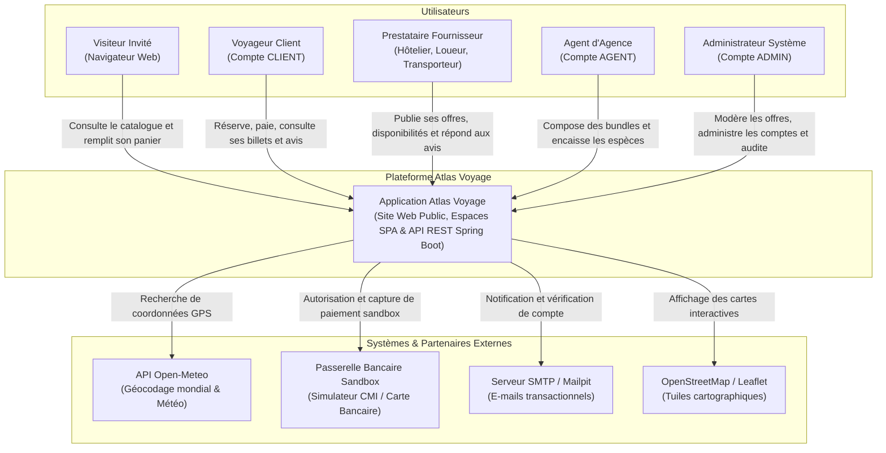

---

## 3. Modèle C4 — Niveau 2 : Diagramme des Conteneurs

Le diagramme des conteneurs détaille la répartition physique et logique des composants en exécution :

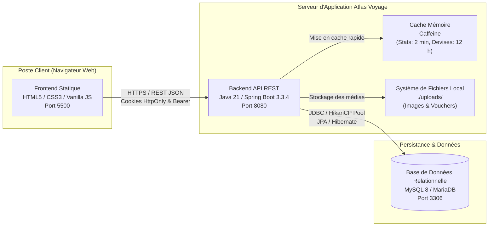

---

## 4. Modèle C4 — Niveau 3 : Diagramme des Composants Backend

Le backend est structuré en modules découplés selon le standard Spring Boot :

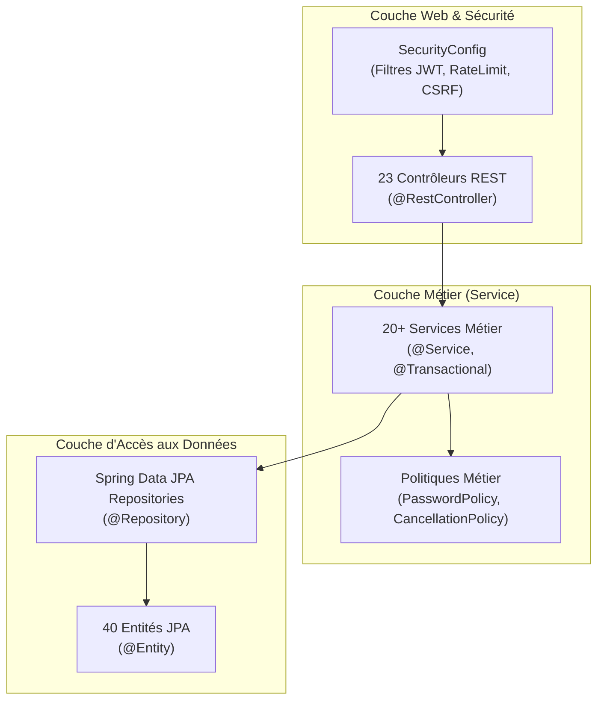

---

## 5. Modèle de Données Entité-Relation (ER)

Atlas Voyage s'appuie sur un schéma relationnel robuste de **40 entités JPA**. Les offres touristiques utilisent l'héritage `SINGLE_TABLE` (`offer_type`).

```mermaid
erDiagram
    User {
        Long id
        String fullName
        String email
        String password
        Role role
        OfferType supplierCategory
        boolean archived
        String phone
    }
    Offer {
        Long id
        String title
        String description
        Double basePrice
        Integer stock
        Boolean allowsPayOnArrival
        Boolean active
        Double averageRating
    }
    Hotel {
        Integer stars
        String roomType
        String address
    }
    Flight {
        String airline
        String flightNumber
        String departureAirport
        String arrivalAirport
        LocalDateTime departureDateTime
        LocalDateTime arrivalDateTime
        Boolean roundTrip
        LocalDateTime returnDepartureDateTime
    }
    Car {
        String brand
        String model
        String transmission
        Integer seats
        String pickupLocation
        String__ dropoffLocations
        Boolean allowsDifferentDropoff
        Integer minimumDriverAge
    }
    TaxiTransfer {
        String pickupLocation
        String dropoffLocation
        String vehicleType
    }
    Excursion {
        Integer durationHours
        Boolean includesGuide
        Boolean includesTransport
        String itinerary
    }
    OfferAvailability {
        Long id
        LocalDateTime startAt
        LocalDateTime endAt
        Integer capacity
    }
    OfferTranslation {
        Long id
        Offer offer
        String locale
        String title
        String description
        String itinerary
        String status
        LocalDateTime updatedAt
    }
    City {
        Long id
        String name
        String normalizedName
        Double latitude
        Double longitude
        String country
        String countryCode
        Boolean hasAirport
    }
    CityTranslation {
        Long id
        City city
        String locale
        String name
    }
    Cart {
        Long id
        User client
        CartItem__ items
        PromoCode promoCode
    }
    CartItem {
        Long id
        Cart cart
        Offer offer
        Bundle bundle
        Integer quantity
        String travelCriteria
    }
    PromoCode {
        Long id
        String code
        DiscountType discountType
        BigDecimal value
        LocalDate expiryDate
        Boolean active
    }
    Bundle {
        Long id
        String title
        String description
        Double discountPercentage
        Offer__ offers
        User createdBy
    }
    Booking {
        Long id
        String reference
        User client
        BookingStatus status
        PaymentStatus paymentStatus
        PaymentMethod paymentMethod
        BigDecimal subtotal
        BigDecimal discount
    }
    BookingItem {
        Long id
        Booking booking
        Offer offer
        Bundle bundle
        BookingItem parentItem
        User supplier
        String titleSnapshot
        Integer quantity
    }
    BookingItemAllocation {
        Long id
        BookingItem bookingItem
        OfferAvailability availability
        Integer quantity
        boolean restored
    }
    Payment {
        Long id
        Booking booking
        User client
        PaymentMethod method
        PaymentStatus status
        BigDecimal amount
        BigDecimal refundedAmount
        BigDecimal reservedRefundAmount
    }
    PaymentEvent {
        Long id
        Payment payment
        PaymentStatus fromStatus
        PaymentStatus toStatus
        String eventType
        User actor
        String actorRole
        String details
    }
    Notification {
        Long id
        User user
        NotificationType type
        String title
        String link
        LocalDateTime readAt
        String referenceType
        Long referenceId
    }
    NotificationPreference {
        Long userId
        boolean emailEnabled
        boolean inAppEnabled
        boolean bookingEmail
        boolean paymentEmail
        boolean offerEmail
        boolean supportEmail
    }
    Favorite {
        Long id
        User client
        Offer offer
        LocalDateTime createdAt
    }
    Review {
        Long id
        Offer offer
        User client
        Booking booking
        Integer rating
        String title
        String comment
        ReviewStatus status
    }
    Ticket {
        Long id
        String reference
        String subject
        TicketCategory category
        TicketPriority priority
        TicketStatus status
        User requester
        User assignee
    }
    TicketMessage {
        Long id
        Ticket ticket
        User author
        String content
        boolean internalNote
        LocalDateTime createdAt
        TicketAttachment__ attachments
    }
    AuditLog {
        Long id
        Long actorId
        String actorEmail
        String actorRole
        String action
        String resourceType
        Long resourceId
        String description
    }
    Setting {
        Long id
        String settingKey
        String settingValue
        SettingType valueType
        String description
        Double minValue
        Double maxValue
        LocalDateTime updatedAt
    }

```

## Dictionnaire de Données (40 Entités JPA)

### Table `AuditLog`

| Attribut / Colonne | Type Java / SQL | Rôle / Description |
| :--- | :--- | :--- |
| `id` | `Long` | Attribut de l'entité AuditLog |
| `actorId` | `Long` | Attribut de l'entité AuditLog |
| `actorEmail` | `String` | Attribut de l'entité AuditLog |
| `actorRole` | `String` | Attribut de l'entité AuditLog |
| `action` | `String` | Attribut de l'entité AuditLog |
| `resourceType` | `String` | Attribut de l'entité AuditLog |
| `resourceId` | `Long` | Attribut de l'entité AuditLog |
| `description` | `String` | Attribut de l'entité AuditLog |
| `beforeJson` | `String` | Attribut de l'entité AuditLog |
| `afterJson` | `String` | Attribut de l'entité AuditLog |
| `ipAddress` | `String` | Attribut de l'entité AuditLog |
| `userAgent` | `String` | Attribut de l'entité AuditLog |
| `createdAt` | `LocalDateTime` | Attribut de l'entité AuditLog |

### Table `Booking`

| Attribut / Colonne | Type Java / SQL | Rôle / Description |
| :--- | :--- | :--- |
| `id` | `Long` | Attribut de l'entité Booking |
| `reference` | `String` | Attribut de l'entité Booking |
| `client` | `User` | Attribut de l'entité Booking |
| `status` | `BookingStatus` | Attribut de l'entité Booking |
| `paymentStatus` | `PaymentStatus` | Attribut de l'entité Booking |
| `paymentMethod` | `PaymentMethod` | Attribut de l'entité Booking |
| `subtotal` | `BigDecimal` | Attribut de l'entité Booking |
| `discount` | `BigDecimal` | Attribut de l'entité Booking |
| `total` | `BigDecimal` | Attribut de l'entité Booking |
| `currency` | `String` | Attribut de l'entité Booking |
| `promoCode` | `PromoCode` | Attribut de l'entité Booking |
| `promoCodeSnapshot` | `String` | Attribut de l'entité Booking |
| `promoTypeSnapshot` | `DiscountType` | Attribut de l'entité Booking |
| `promoValueSnapshot` | `BigDecimal` | Attribut de l'entité Booking |
| `createdAt` | `LocalDateTime` | Attribut de l'entité Booking |
| `confirmedAt` | `LocalDateTime` | Attribut de l'entité Booking |
| `cancelledAt` | `LocalDateTime` | Attribut de l'entité Booking |
| `expiresAt` | `LocalDateTime` | Attribut de l'entité Booking |
| `serviceStartAt` | `LocalDateTime` | Attribut de l'entité Booking |
| `serviceEndAt` | `LocalDateTime` | Attribut de l'entité Booking |
| `cancellationReason` | `String` | Attribut de l'entité Booking |
| `cancelledBy` | `Long` | Attribut de l'entité Booking |
| `contactPhone` | `String` | Attribut de l'entité Booking |
| `notes` | `String` | Attribut de l'entité Booking |
| `version` | `Long` | Attribut de l'entité Booking |
| `items` | `BookingItem[]` | Attribut de l'entité Booking |

### Table `BookingItem`

| Attribut / Colonne | Type Java / SQL | Rôle / Description |
| :--- | :--- | :--- |
| `id` | `Long` | Attribut de l'entité BookingItem |
| `booking` | `Booking` | Attribut de l'entité BookingItem |
| `offer` | `Offer` | Attribut de l'entité BookingItem |
| `bundle` | `Bundle` | Attribut de l'entité BookingItem |
| `parentItem` | `BookingItem` | Attribut de l'entité BookingItem |
| `supplier` | `User` | Attribut de l'entité BookingItem |
| `titleSnapshot` | `String` | Attribut de l'entité BookingItem |
| `quantity` | `Integer` | Attribut de l'entité BookingItem |
| `unitPrice` | `BigDecimal` | Attribut de l'entité BookingItem |
| `lineTotal` | `BigDecimal` | Attribut de l'entité BookingItem |
| `travelCriteria` | `String` | Attribut de l'entité BookingItem |
| `serviceStartAt` | `LocalDateTime` | Attribut de l'entité BookingItem |
| `serviceEndAt` | `LocalDateTime` | Attribut de l'entité BookingItem |
| `allocations` | `BookingItemAllocation[]` | Attribut de l'entité BookingItem |

### Table `BookingItemAllocation`

| Attribut / Colonne | Type Java / SQL | Rôle / Description |
| :--- | :--- | :--- |
| `id` | `Long` | Attribut de l'entité BookingItemAllocation |
| `bookingItem` | `BookingItem` | Attribut de l'entité BookingItemAllocation |
| `availability` | `OfferAvailability` | Attribut de l'entité BookingItemAllocation |
| `quantity` | `Integer` | Attribut de l'entité BookingItemAllocation |
| `restored` | `boolean` | Attribut de l'entité BookingItemAllocation |

### Table `BookingSequence`

| Attribut / Colonne | Type Java / SQL | Rôle / Description |
| :--- | :--- | :--- |
| `year` | `Integer` | Attribut de l'entité BookingSequence |
| `lastValue` | `Long` | Attribut de l'entité BookingSequence |

### Table `Bundle`

| Attribut / Colonne | Type Java / SQL | Rôle / Description |
| :--- | :--- | :--- |
| `id` | `Long` | Attribut de l'entité Bundle |
| `title` | `String` | Attribut de l'entité Bundle |
| `description` | `String` | Attribut de l'entité Bundle |
| `discountPercentage` | `Double` | Attribut de l'entité Bundle |
| `offers` | `Offer[]` | Attribut de l'entité Bundle |
| `createdBy` | `User` | Attribut de l'entité Bundle |

### Table `Car`

| Attribut / Colonne | Type Java / SQL | Rôle / Description |
| :--- | :--- | :--- |
| `brand` | `String` | Attribut de l'entité Car |
| `model` | `String` | Attribut de l'entité Car |
| `transmission` | `String` | Attribut de l'entité Car |
| `seats` | `Integer` | Attribut de l'entité Car |
| `pickupLocation` | `String` | Attribut de l'entité Car |
| `dropoffLocations` | `String[]` | Attribut de l'entité Car |
| `allowsDifferentDropoff` | `Boolean` | Attribut de l'entité Car |
| `minimumDriverAge` | `Integer` | Attribut de l'entité Car |
| `maximumDriverAge` | `Integer` | Attribut de l'entité Car |

### Table `Cart`

| Attribut / Colonne | Type Java / SQL | Rôle / Description |
| :--- | :--- | :--- |
| `id` | `Long` | Attribut de l'entité Cart |
| `client` | `User` | Attribut de l'entité Cart |
| `items` | `CartItem[]` | Attribut de l'entité Cart |
| `promoCode` | `PromoCode` | Attribut de l'entité Cart |

### Table `CartItem`

| Attribut / Colonne | Type Java / SQL | Rôle / Description |
| :--- | :--- | :--- |
| `id` | `Long` | Attribut de l'entité CartItem |
| `cart` | `Cart` | Attribut de l'entité CartItem |
| `offer` | `Offer` | Attribut de l'entité CartItem |
| `bundle` | `Bundle` | Attribut de l'entité CartItem |
| `quantity` | `Integer` | Attribut de l'entité CartItem |
| `travelCriteria` | `String` | Attribut de l'entité CartItem |

### Table `City`

| Attribut / Colonne | Type Java / SQL | Rôle / Description |
| :--- | :--- | :--- |
| `id` | `Long` | Attribut de l'entité City |
| `name` | `String` | Attribut de l'entité City |
| `normalizedName` | `String` | Attribut de l'entité City |
| `latitude` | `Double` | Attribut de l'entité City |
| `longitude` | `Double` | Attribut de l'entité City |
| `country` | `String` | Attribut de l'entité City |
| `countryCode` | `String` | Attribut de l'entité City |
| `hasAirport` | `Boolean` | Attribut de l'entité City |

### Table `CityTranslation`

| Attribut / Colonne | Type Java / SQL | Rôle / Description |
| :--- | :--- | :--- |
| `id` | `Long` | Attribut de l'entité CityTranslation |
| `city` | `City` | Attribut de l'entité CityTranslation |
| `locale` | `String` | Attribut de l'entité CityTranslation |
| `name` | `String` | Attribut de l'entité CityTranslation |

### Table `ContactMessage`

| Attribut / Colonne | Type Java / SQL | Rôle / Description |
| :--- | :--- | :--- |
| `id` | `Long` | Attribut de l'entité ContactMessage |
| `name` | `String` | Attribut de l'entité ContactMessage |
| `email` | `String` | Attribut de l'entité ContactMessage |
| `subject` | `String` | Attribut de l'entité ContactMessage |
| `message` | `String` | Attribut de l'entité ContactMessage |
| `ipAddress` | `String` | Attribut de l'entité ContactMessage |
| `processed` | `Boolean` | Attribut de l'entité ContactMessage |
| `createdAt` | `LocalDateTime` | Attribut de l'entité ContactMessage |

### Table `EmailVerificationToken`

| Attribut / Colonne | Type Java / SQL | Rôle / Description |
| :--- | :--- | :--- |

### Table `Excursion`

| Attribut / Colonne | Type Java / SQL | Rôle / Description |
| :--- | :--- | :--- |
| `durationHours` | `Integer` | Attribut de l'entité Excursion |
| `includesGuide` | `Boolean` | Attribut de l'entité Excursion |
| `includesTransport` | `Boolean` | Attribut de l'entité Excursion |
| `itinerary` | `String` | Attribut de l'entité Excursion |

### Table `Favorite`

| Attribut / Colonne | Type Java / SQL | Rôle / Description |
| :--- | :--- | :--- |
| `id` | `Long` | Attribut de l'entité Favorite |
| `client` | `User` | Attribut de l'entité Favorite |
| `offer` | `Offer` | Attribut de l'entité Favorite |
| `createdAt` | `LocalDateTime` | Attribut de l'entité Favorite |

### Table `FileAsset`

| Attribut / Colonne | Type Java / SQL | Rôle / Description |
| :--- | :--- | :--- |

### Table `Flight`

| Attribut / Colonne | Type Java / SQL | Rôle / Description |
| :--- | :--- | :--- |
| `airline` | `String` | Attribut de l'entité Flight |
| `flightNumber` | `String` | Attribut de l'entité Flight |
| `departureAirport` | `String` | Attribut de l'entité Flight |
| `arrivalAirport` | `String` | Attribut de l'entité Flight |
| `departureDateTime` | `LocalDateTime` | Attribut de l'entité Flight |
| `arrivalDateTime` | `LocalDateTime` | Attribut de l'entité Flight |
| `roundTrip` | `Boolean` | Attribut de l'entité Flight |
| `returnDepartureDateTime` | `LocalDateTime` | Attribut de l'entité Flight |
| `returnArrivalDateTime` | `LocalDateTime` | Attribut de l'entité Flight |
| `cabinClass` | `String` | Attribut de l'entité Flight |

### Table `Hotel`

| Attribut / Colonne | Type Java / SQL | Rôle / Description |
| :--- | :--- | :--- |
| `stars` | `Integer` | Attribut de l'entité Hotel |
| `roomType` | `String` | Attribut de l'entité Hotel |
| `address` | `String` | Attribut de l'entité Hotel |

### Table `IdempotencyRecord`

| Attribut / Colonne | Type Java / SQL | Rôle / Description |
| :--- | :--- | :--- |
| `id` | `Long` | Attribut de l'entité IdempotencyRecord |
| `key` | `String` | Attribut de l'entité IdempotencyRecord |
| `user` | `User` | Attribut de l'entité IdempotencyRecord |
| `endpoint` | `String` | Attribut de l'entité IdempotencyRecord |
| `requestHash` | `String` | Attribut de l'entité IdempotencyRecord |
| `responseStatus` | `Integer` | Attribut de l'entité IdempotencyRecord |
| `responseBody` | `String` | Attribut de l'entité IdempotencyRecord |
| `paymentId` | `Long` | Attribut de l'entité IdempotencyRecord |
| `operationAmount` | `BigDecimal` | Attribut de l'entité IdempotencyRecord |
| `createdAt` | `LocalDateTime` | Attribut de l'entité IdempotencyRecord |
| `expiresAt` | `LocalDateTime` | Attribut de l'entité IdempotencyRecord |

### Table `Notification`

| Attribut / Colonne | Type Java / SQL | Rôle / Description |
| :--- | :--- | :--- |
| `id` | `Long` | Attribut de l'entité Notification |
| `user` | `User` | Attribut de l'entité Notification |
| `type` | `NotificationType` | Attribut de l'entité Notification |
| `title` | `String` | Attribut de l'entité Notification |
| `link` | `String` | Attribut de l'entité Notification |
| `readAt` | `LocalDateTime` | Attribut de l'entité Notification |
| `referenceType` | `String` | Attribut de l'entité Notification |
| `referenceId` | `Long` | Attribut de l'entité Notification |
| `dedupKey` | `String` | Attribut de l'entité Notification |
| `message` | `String` | Attribut de l'entité Notification |
| `isRead` | `Boolean` | Attribut de l'entité Notification |
| `createdAt` | `LocalDateTime` | Attribut de l'entité Notification |

### Table `NotificationDispatch`

| Attribut / Colonne | Type Java / SQL | Rôle / Description |
| :--- | :--- | :--- |
| `id` | `Long` | Attribut de l'entité NotificationDispatch |
| `userId` | `Long` | Attribut de l'entité NotificationDispatch |
| `dedupKey` | `String` | Attribut de l'entité NotificationDispatch |
| `createdAt` | `LocalDateTime` | Attribut de l'entité NotificationDispatch |

### Table `NotificationPreference`

| Attribut / Colonne | Type Java / SQL | Rôle / Description |
| :--- | :--- | :--- |
| `userId` | `Long` | Attribut de l'entité NotificationPreference |
| `emailEnabled` | `boolean` | Attribut de l'entité NotificationPreference |
| `inAppEnabled` | `boolean` | Attribut de l'entité NotificationPreference |
| `bookingEmail` | `boolean` | Attribut de l'entité NotificationPreference |
| `paymentEmail` | `boolean` | Attribut de l'entité NotificationPreference |
| `offerEmail` | `boolean` | Attribut de l'entité NotificationPreference |
| `supportEmail` | `boolean` | Attribut de l'entité NotificationPreference |

### Table `Offer`

| Attribut / Colonne | Type Java / SQL | Rôle / Description |
| :--- | :--- | :--- |
| `id` | `Long` | Attribut de l'entité Offer |
| `title` | `String` | Attribut de l'entité Offer |
| `description` | `String` | Attribut de l'entité Offer |
| `basePrice` | `Double` | Attribut de l'entité Offer |
| `stock` | `Integer` | Attribut de l'entité Offer |
| `allowsPayOnArrival` | `Boolean` | Attribut de l'entité Offer |
| `active` | `Boolean` | Attribut de l'entité Offer |
| `averageRating` | `Double` | Attribut de l'entité Offer |
| `reviewCount` | `Integer` | Attribut de l'entité Offer |
| `availabilities` | `OfferAvailability[]` | Attribut de l'entité Offer |
| `moderationReason` | `String` | Attribut de l'entité Offer |
| `moderatedAt` | `LocalDateTime` | Attribut de l'entité Offer |
| `moderatedBy` | `User` | Attribut de l'entité Offer |
| `images` | `String[]` | Attribut de l'entité Offer |
| `city` | `City` | Attribut de l'entité Offer |
| `supplier` | `User` | Attribut de l'entité Offer |

### Table `OfferAvailability`

| Attribut / Colonne | Type Java / SQL | Rôle / Description |
| :--- | :--- | :--- |
| `id` | `Long` | Attribut de l'entité OfferAvailability |
| `startAt` | `LocalDateTime` | Attribut de l'entité OfferAvailability |
| `endAt` | `LocalDateTime` | Attribut de l'entité OfferAvailability |
| `capacity` | `Integer` | Attribut de l'entité OfferAvailability |

### Table `OfferTranslation`

| Attribut / Colonne | Type Java / SQL | Rôle / Description |
| :--- | :--- | :--- |
| `id` | `Long` | Attribut de l'entité OfferTranslation |
| `offer` | `Offer` | Attribut de l'entité OfferTranslation |
| `locale` | `String` | Attribut de l'entité OfferTranslation |
| `title` | `String` | Attribut de l'entité OfferTranslation |
| `description` | `String` | Attribut de l'entité OfferTranslation |
| `itinerary` | `String` | Attribut de l'entité OfferTranslation |
| `status` | `String` | Attribut de l'entité OfferTranslation |
| `updatedAt` | `LocalDateTime` | Attribut de l'entité OfferTranslation |

### Table `PasswordResetToken`

| Attribut / Colonne | Type Java / SQL | Rôle / Description |
| :--- | :--- | :--- |

### Table `Payment`

| Attribut / Colonne | Type Java / SQL | Rôle / Description |
| :--- | :--- | :--- |
| `id` | `Long` | Attribut de l'entité Payment |
| `booking` | `Booking` | Attribut de l'entité Payment |
| `client` | `User` | Attribut de l'entité Payment |
| `method` | `PaymentMethod` | Attribut de l'entité Payment |
| `status` | `PaymentStatus` | Attribut de l'entité Payment |
| `amount` | `BigDecimal` | Attribut de l'entité Payment |
| `refundedAmount` | `BigDecimal` | Attribut de l'entité Payment |
| `reservedRefundAmount` | `BigDecimal` | Attribut de l'entité Payment |
| `currency` | `String` | Attribut de l'entité Payment |
| `provider` | `String` | Attribut de l'entité Payment |
| `providerReference` | `String` | Attribut de l'entité Payment |
| `idempotencyKey` | `String` | Attribut de l'entité Payment |
| `activeBookingId` | `Long` | Attribut de l'entité Payment |
| `cardBrand` | `String` | Attribut de l'entité Payment |
| `cardLast4` | `String` | Attribut de l'entité Payment |
| `failureCode` | `String` | Attribut de l'entité Payment |
| `failureMessage` | `String` | Attribut de l'entité Payment |
| `collectedBy` | `User` | Attribut de l'entité Payment |
| `createdAt` | `LocalDateTime` | Attribut de l'entité Payment |
| `updatedAt` | `LocalDateTime` | Attribut de l'entité Payment |
| `paidAt` | `LocalDateTime` | Attribut de l'entité Payment |
| `refundedAt` | `LocalDateTime` | Attribut de l'entité Payment |
| `version` | `Long` | Attribut de l'entité Payment |

### Table `PaymentEvent`

| Attribut / Colonne | Type Java / SQL | Rôle / Description |
| :--- | :--- | :--- |
| `id` | `Long` | Attribut de l'entité PaymentEvent |
| `payment` | `Payment` | Attribut de l'entité PaymentEvent |
| `fromStatus` | `PaymentStatus` | Attribut de l'entité PaymentEvent |
| `toStatus` | `PaymentStatus` | Attribut de l'entité PaymentEvent |
| `eventType` | `String` | Attribut de l'entité PaymentEvent |
| `actor` | `User` | Attribut de l'entité PaymentEvent |
| `actorRole` | `String` | Attribut de l'entité PaymentEvent |
| `details` | `String` | Attribut de l'entité PaymentEvent |
| `createdAt` | `LocalDateTime` | Attribut de l'entité PaymentEvent |

### Table `PromoCode`

| Attribut / Colonne | Type Java / SQL | Rôle / Description |
| :--- | :--- | :--- |
| `id` | `Long` | Attribut de l'entité PromoCode |
| `code` | `String` | Attribut de l'entité PromoCode |
| `discountType` | `DiscountType` | Attribut de l'entité PromoCode |
| `value` | `BigDecimal` | Attribut de l'entité PromoCode |
| `expiryDate` | `LocalDate` | Attribut de l'entité PromoCode |
| `active` | `Boolean` | Attribut de l'entité PromoCode |

### Table `RefreshToken`

| Attribut / Colonne | Type Java / SQL | Rôle / Description |
| :--- | :--- | :--- |
| `id` | `Long` | Attribut de l'entité RefreshToken |
| `userId` | `Long` | Attribut de l'entité RefreshToken |
| `tokenHash` | `String` | Attribut de l'entité RefreshToken |
| `familyId` | `String` | Attribut de l'entité RefreshToken |
| `expiresAt` | `LocalDateTime` | Attribut de l'entité RefreshToken |
| `revokedAt` | `LocalDateTime` | Attribut de l'entité RefreshToken |
| `replacedBy` | `String` | Attribut de l'entité RefreshToken |
| `createdAt` | `LocalDateTime` | Attribut de l'entité RefreshToken |
| `ipAddress` | `String` | Attribut de l'entité RefreshToken |
| `userAgent` | `String` | Attribut de l'entité RefreshToken |

### Table `Review`

| Attribut / Colonne | Type Java / SQL | Rôle / Description |
| :--- | :--- | :--- |
| `id` | `Long` | Attribut de l'entité Review |
| `offer` | `Offer` | Attribut de l'entité Review |
| `client` | `User` | Attribut de l'entité Review |
| `booking` | `Booking` | Attribut de l'entité Review |
| `rating` | `Integer` | Attribut de l'entité Review |
| `title` | `String` | Attribut de l'entité Review |
| `comment` | `String` | Attribut de l'entité Review |
| `status` | `ReviewStatus` | Attribut de l'entité Review |
| `moderatedBy` | `User` | Attribut de l'entité Review |
| `moderatedAt` | `LocalDateTime` | Attribut de l'entité Review |
| `moderationReason` | `String` | Attribut de l'entité Review |
| `supplierReply` | `String` | Attribut de l'entité Review |
| `supplierRepliedAt` | `LocalDateTime` | Attribut de l'entité Review |
| `reportCount` | `Integer` | Attribut de l'entité Review |
| `createdAt` | `LocalDateTime` | Attribut de l'entité Review |
| `updatedAt` | `LocalDateTime` | Attribut de l'entité Review |

### Table `Setting`

| Attribut / Colonne | Type Java / SQL | Rôle / Description |
| :--- | :--- | :--- |
| `id` | `Long` | Attribut de l'entité Setting |
| `settingKey` | `String` | Attribut de l'entité Setting |
| `settingValue` | `String` | Attribut de l'entité Setting |
| `valueType` | `SettingType` | Attribut de l'entité Setting |
| `description` | `String` | Attribut de l'entité Setting |
| `minValue` | `Double` | Attribut de l'entité Setting |
| `maxValue` | `Double` | Attribut de l'entité Setting |
| `updatedAt` | `LocalDateTime` | Attribut de l'entité Setting |
| `updatedBy` | `String` | Attribut de l'entité Setting |

### Table `SupplierProfile`

| Attribut / Colonne | Type Java / SQL | Rôle / Description |
| :--- | :--- | :--- |

### Table `TaxiTransfer`

| Attribut / Colonne | Type Java / SQL | Rôle / Description |
| :--- | :--- | :--- |
| `pickupLocation` | `String` | Attribut de l'entité TaxiTransfer |
| `dropoffLocation` | `String` | Attribut de l'entité TaxiTransfer |
| `vehicleType` | `String` | Attribut de l'entité TaxiTransfer |

### Table `Ticket`

| Attribut / Colonne | Type Java / SQL | Rôle / Description |
| :--- | :--- | :--- |
| `id` | `Long` | Attribut de l'entité Ticket |
| `reference` | `String` | Attribut de l'entité Ticket |
| `subject` | `String` | Attribut de l'entité Ticket |
| `category` | `TicketCategory` | Attribut de l'entité Ticket |
| `priority` | `TicketPriority` | Attribut de l'entité Ticket |
| `status` | `TicketStatus` | Attribut de l'entité Ticket |
| `requester` | `User` | Attribut de l'entité Ticket |
| `assignee` | `User` | Attribut de l'entité Ticket |
| `booking` | `Booking` | Attribut de l'entité Ticket |
| `createdAt` | `LocalDateTime` | Attribut de l'entité Ticket |
| `updatedAt` | `LocalDateTime` | Attribut de l'entité Ticket |
| `resolvedAt` | `LocalDateTime` | Attribut de l'entité Ticket |
| `closedAt` | `LocalDateTime` | Attribut de l'entité Ticket |
| `messages` | `TicketMessage[]` | Attribut de l'entité Ticket |

### Table `TicketAttachment`

| Attribut / Colonne | Type Java / SQL | Rôle / Description |
| :--- | :--- | :--- |
| `id` | `Long` | Attribut de l'entité TicketAttachment |
| `message` | `TicketMessage` | Attribut de l'entité TicketAttachment |
| `name` | `String` | Attribut de l'entité TicketAttachment |
| `url` | `String` | Attribut de l'entité TicketAttachment |
| `mimeType` | `String` | Attribut de l'entité TicketAttachment |
| `size` | `Long` | Attribut de l'entité TicketAttachment |

### Table `TicketMessage`

| Attribut / Colonne | Type Java / SQL | Rôle / Description |
| :--- | :--- | :--- |
| `id` | `Long` | Attribut de l'entité TicketMessage |
| `ticket` | `Ticket` | Attribut de l'entité TicketMessage |
| `author` | `User` | Attribut de l'entité TicketMessage |
| `content` | `String` | Attribut de l'entité TicketMessage |
| `internalNote` | `boolean` | Attribut de l'entité TicketMessage |
| `createdAt` | `LocalDateTime` | Attribut de l'entité TicketMessage |
| `attachments` | `TicketAttachment[]` | Attribut de l'entité TicketMessage |

### Table `TicketSequence`

| Attribut / Colonne | Type Java / SQL | Rôle / Description |
| :--- | :--- | :--- |
| `year` | `Integer` | Attribut de l'entité TicketSequence |
| `lastValue` | `Long` | Attribut de l'entité TicketSequence |

### Table `User`

| Attribut / Colonne | Type Java / SQL | Rôle / Description |
| :--- | :--- | :--- |
| `id` | `Long` | Attribut de l'entité User |
| `fullName` | `String` | Attribut de l'entité User |
| `email` | `String` | Attribut de l'entité User |
| `password` | `String` | Attribut de l'entité User |
| `role` | `Role` | Attribut de l'entité User |
| `supplierCategory` | `OfferType` | Attribut de l'entité User |
| `archived` | `boolean` | Attribut de l'entité User |
| `phone` | `String` | Attribut de l'entité User |
| `country` | `String` | Attribut de l'entité User |
| `avatarUrl` | `String` | Attribut de l'entité User |
| `emailVerified` | `boolean` | Attribut de l'entité User |
| `tokenVersion` | `long` | Attribut de l'entité User |
| `createdAtEstimated` | `boolean` | Attribut de l'entité User |
| `failedLoginAttempts` | `int` | Attribut de l'entité User |
| `consentVersion` | `String` | Attribut de l'entité User |
| `preferredLanguage` | `String` | Attribut de l'entité User |
| `preferredCurrency` | `String` | Attribut de l'entité User |
| `marketingOptIn` | `boolean` | Attribut de l'entité User |

### Table `WebhookEvent`

| Attribut / Colonne | Type Java / SQL | Rôle / Description |
| :--- | :--- | :--- |
| `id` | `Long` | Attribut de l'entité WebhookEvent |
| `provider` | `String` | Attribut de l'entité WebhookEvent |
| `eventId` | `String` | Attribut de l'entité WebhookEvent |
| `type` | `String` | Attribut de l'entité WebhookEvent |
| `payloadHash` | `String` | Attribut de l'entité WebhookEvent |
| `receivedAt` | `LocalDateTime` | Attribut de l'entité WebhookEvent |
| `processedAt` | `LocalDateTime` | Attribut de l'entité WebhookEvent |
| `status` | `String` | Attribut de l'entité WebhookEvent |

---

## 6. Diagrammes de Séquence des Parcours Clés

### 6.1 Authentification avec Détection de Rejeu (Refresh Token Rotation)

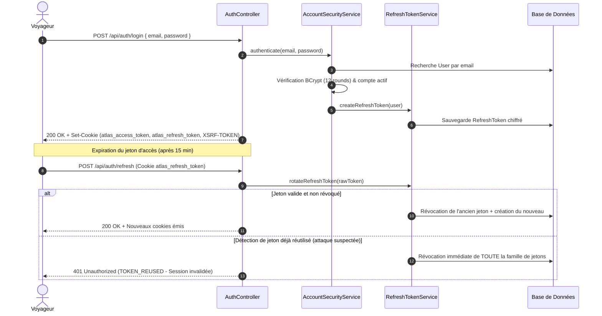

### 6.2 Réservation Atomique du Panier avec Verrouillage Pessimiste

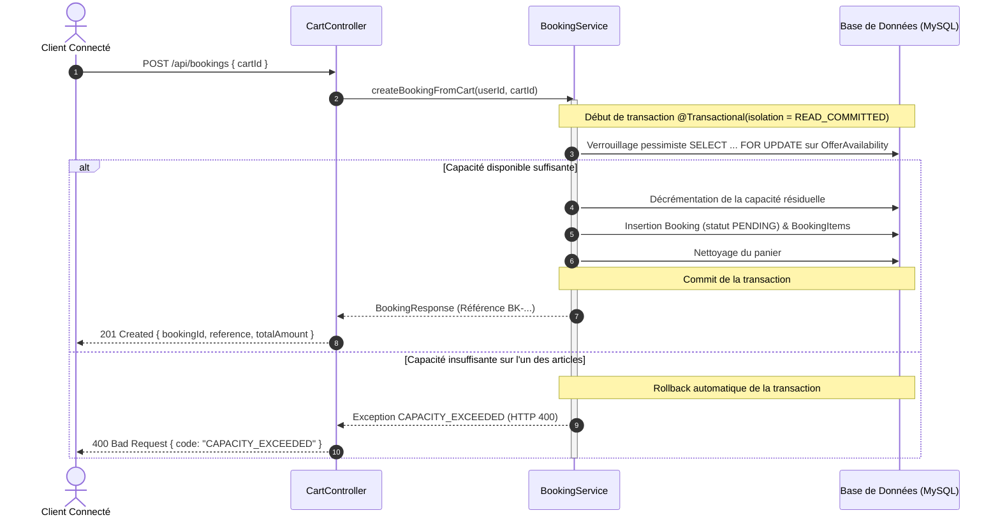

### 6.3 Paiement Sécurisé & Idempotence

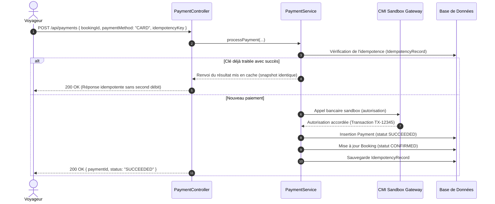

### 6.4 Annulation de Réservation & Restitution de Capacité

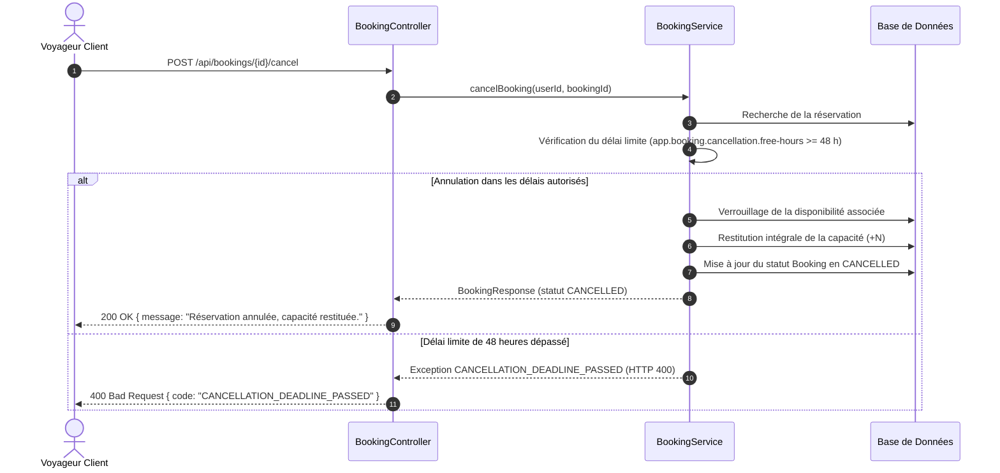

---

## 7. Diagrammes d'États des Cycles de Vie Métier

### 7.1 Cycle de Vie d'une Réservation (`Booking`)

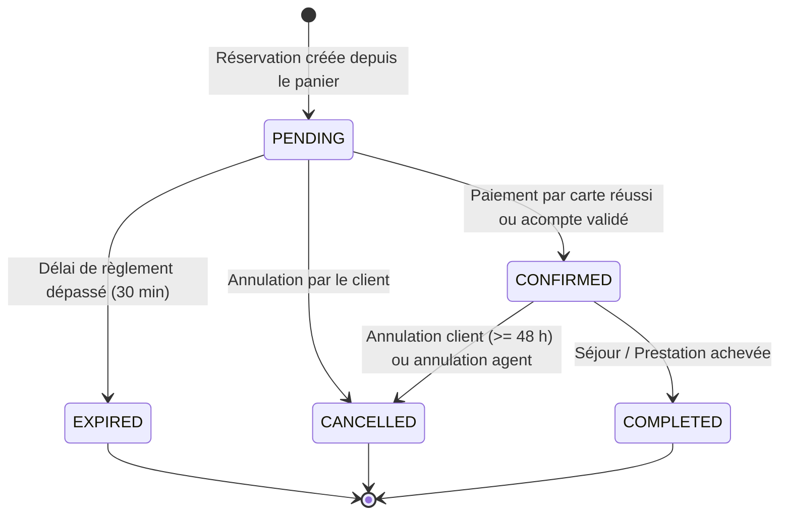

### 7.2 Cycle de Vie d'un Paiement (`Payment`)

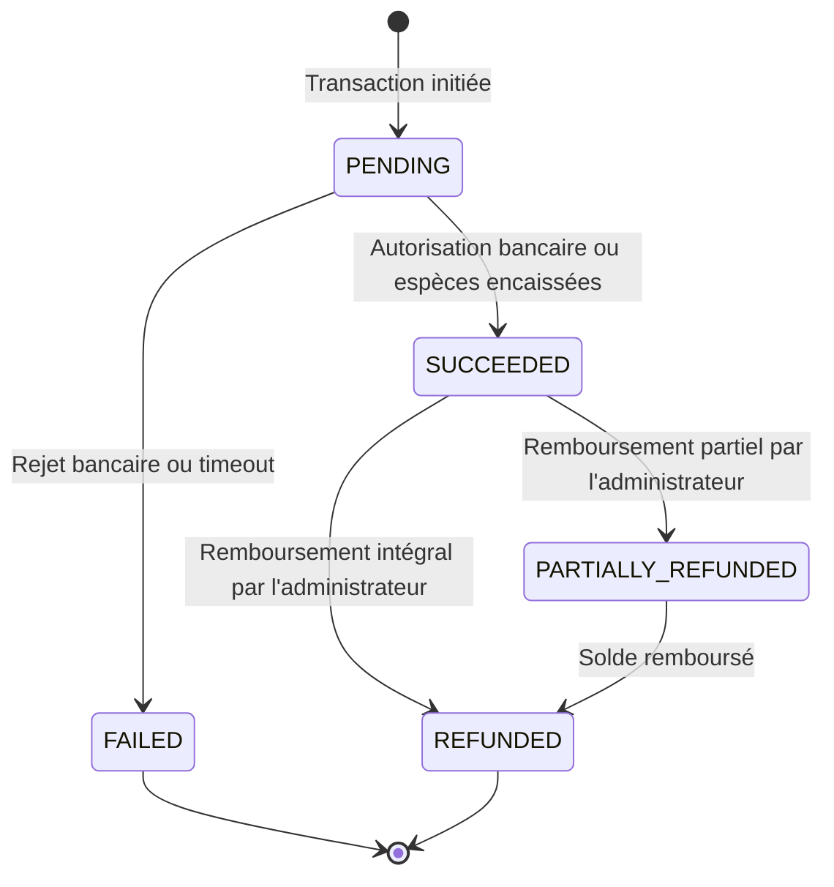

### 7.3 Cycle de Vie d'un Ticket de Support (`Ticket`)

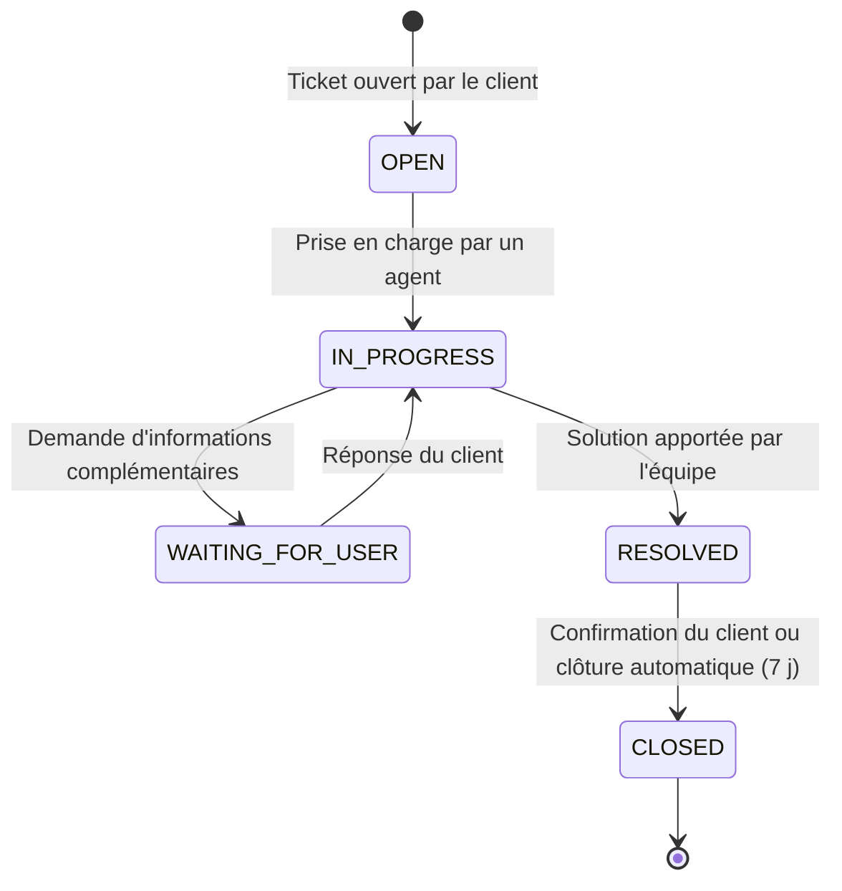

### 7.4 Cycle de Vie d'un Avis Client (`Review`)

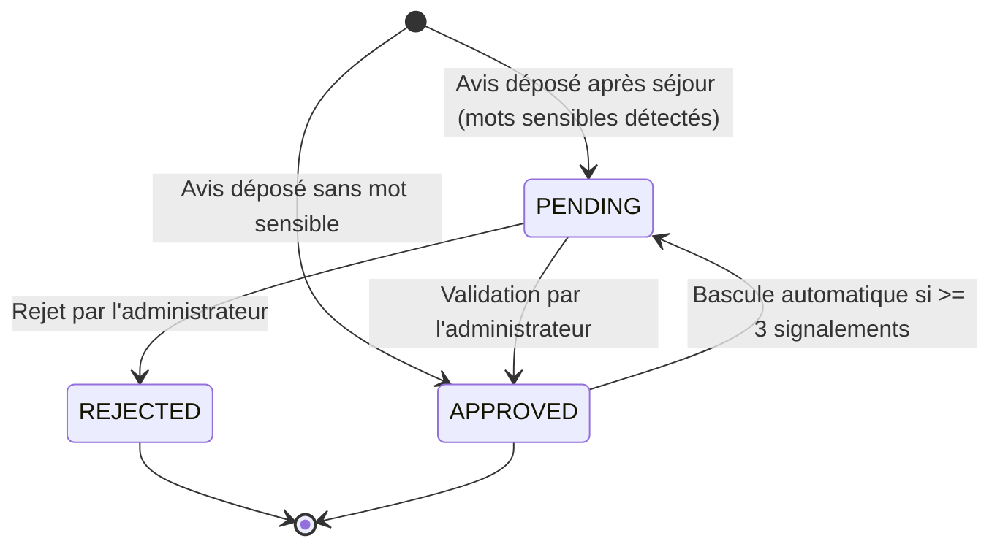

---

## 8. Index des Décisions d'Architecture (ADR)

Les choix technologiques majeurs sont documentés selon le format MADR sous [`docs/adr/`](adr/) :

- [`ADR-0001`](adr/0001-single-table-inheritance-offres.md) : Stratégie d'héritage `SINGLE_TABLE` pour les offres touristiques.
- [`ADR-0002`](adr/0002-disponibilites-par-periodes-vs-stock.md) : Disponibilités par périodes datées plutôt qu'un stock statique.
- [`ADR-0003`](adr/0003-fournisseurs-specialises-par-categorie.md) : Spécialisation stricte des comptes fournisseurs par catégorie.
- [`ADR-0004`](adr/0004-dirham-marocain-reference-devises-indicatives.md) : Dirham Marocain (MAD) comme devise unique de référence.
- [`ADR-0005`](adr/0005-authentification-jwt-cookies-httponly-rotation-refresh.md) : Authentification double support (Cookies HttpOnly et Bearer).
- [`ADR-0006`](adr/0006-flyway-et-migrations-sql-idempotentes.md) : Gestion des migrations de base de données.
- [`ADR-0007`](adr/0007-geocodage-resilient-open-meteo.md) : Géocodage résilient mondial sans clé API payante.
- [`ADR-0008`](adr/0008-catalogue-public-unique.md) : Catalogue public unique partagé.
- [`ADR-0009`](adr/0009-i18n-runtime-vanilla-vs-build-time.md) : Moteur d'internationalisation runtime Vanilla JS.
- [`ADR-0010`](adr/0010-cache-caffeine-mono-instance.md) : Mise en cache mémoire locale Caffeine.
