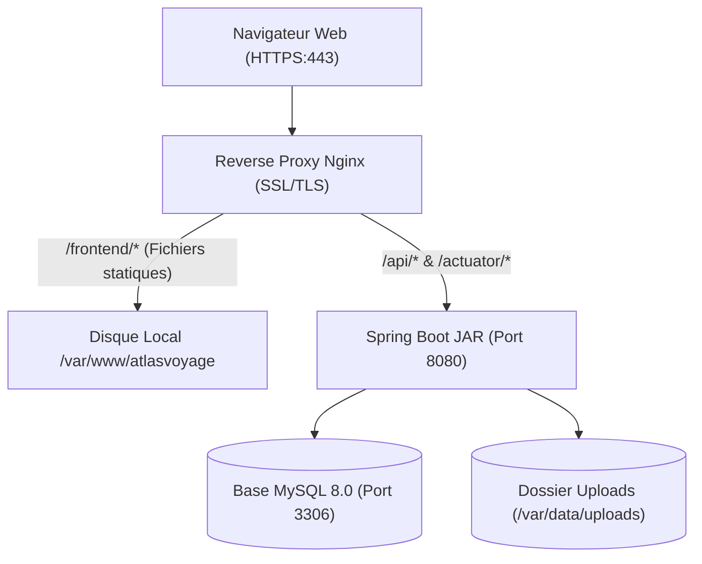

# Procédure de Déploiement en Production

> **Statut :** ✅ Implémenté  
> **Date de mise à jour :** 2026-11-01  
> **Auteur :** Équipe DevOps Atlas Voyage  
> **Système cible :** Linux Ubuntu 22.04 LTS / Debian 12

---

## 1. Prérequis d'Infrastructure

- **Serveur hôte :** 2 vCPU, 4 Go RAM minimum, 20 Go disque SSD.
- **Runtime Java :** Eclipse Temurin JDK 21 LTS installé (`apt install temurin-21-jdk`).
- **Serveur Web & Reverse Proxy :** Nginx 1.22+ avec module SSL.
- **Base de données :** MySQL 8.0+ hébergé en local ou sur un service managé (Amazon RDS, DigitalOcean Managed DB).

---

## 2. Architecture de Déploiement



---

## 3. Déploiement Pas-à-Pas

### Étape 1 : Création de l'utilisateur système dédié
```bash
sudo useradd -r -s /bin/false atlasvoyage
sudo mkdir -p /var/data/atlasvoyage/uploads
sudo chown -R atlasvoyage:atlasvoyage /var/data/atlasvoyage
```

### Étape 2 : Compilation du JAR de production
Sur la machine de build ou dans le pipeline CI :
```bash
cd backend
./mvnw clean package -DskipTests
# Le binaire produit est : target/travel-agency-backend-0.0.1-SNAPSHOT.jar
```

### Étape 3 : Transfert et installation sur le serveur
```bash
scp target/travel-agency-backend-0.0.1-SNAPSHOT.jar user@srv-prod:/opt/atlasvoyage/backend.jar
rsync -avz --delete frontend/ user@srv-prod:/var/www/atlasvoyage/frontend/
```

### Étape 4 : Configuration du service Systemd
Créer le fichier `/etc/systemd/system/atlasvoyage.service` :

```ini
[Unit]
Description=Atlas Voyage Spring Boot Backend
After=network.target mysql.service

[Service]
Type=simple
User=atlasvoyage
Group=atlasvoyage
WorkingDirectory=/opt/atlasvoyage
EnvironmentFile=/etc/atlasvoyage/atlasvoyage.env
ExecStart=/usr/bin/java -Xms512m -Xmx1536m -jar /opt/atlasvoyage/backend.jar
Restart=always
RestartSec=10
LimitNOFILE=65536

[Install]
WantedBy=multi-user.target
```

### Étape 5 : Variables d'environnement sécurisées
Créer `/etc/atlasvoyage/atlasvoyage.env` (droits stricts `chmod 600`) :

```ini
SPRING_PROFILES_ACTIVE=prod
DB_URL=jdbc:mysql://localhost:3306/travel_agency_db?useSSL=true&serverTimezone=UTC
DB_USERNAME=atlas_app
DB_PASSWORD=<VOTRE_MOT_DE_PASSE_MYSQL_FORT>
JWT_SECRET=<VOTRE_CLE_BASE64_256BITS>
VOUCHER_SECRET=<VOTRE_CLE_VOUCHER_16CHARS>
PAYMENT_PROVIDER=cmi
PAYMENT_WEBHOOK_SECRET=<VOTRE_CLE_HMAC_CMI_32CHARS>
CORS_ALLOWED_ORIGINS=https://atlasvoyage.ma
APP_BASE_URL=https://atlasvoyage.ma/frontend
UPLOAD_ROOT=/var/data/atlasvoyage/uploads
MAIL_ENABLED=true
SMTP_HOST=smtp.sendgrid.net
SMTP_PORT=587
SMTP_USERNAME=apikey
SMTP_PASSWORD=<VOTRE_CLE_API_SMTP>
```

### Étape 6 : Configuration Nginx
Créer `/etc/nginx/sites-available/atlasvoyage.conf` :

```nginx
server {
    listen 80;
    server_name atlasvoyage.ma www.atlasvoyage.ma;
    return 301 https://$host$request_uri;
}

server {
    listen 443 ssl http2;
    server_name atlasvoyage.ma www.atlasvoyage.ma;

    ssl_certificate /etc/letsencrypt/live/atlasvoyage.ma/fullchain.pem;
    ssl_certificate_key /etc/letsencrypt/live/atlasvoyage.ma/privkey.pem;

    # En-têtes de sécurité OWASP
    add_header X-Content-Type-Options nosniff always;
    add_header X-Frame-Options DENY always;
    add_header X-XSS-Protection "1; mode=block" always;
    add_header Referrer-Policy "strict-origin-when-cross-origin" always;

    # Fichiers statiques Frontend
    location /frontend/ {
        alias /var/www/atlasvoyage/frontend/;
        try_files $uri $uri/ =404;
        expires 1h;
        add_header Cache-Control "public, no-transform";
    }

    # Redirection racine vers accueil
    location = / {
        return 302 /frontend/accueil.html;
    }

    # API REST Spring Boot
    location /api/ {
        proxy_pass http://127.0.0.1:8080/api/;
        proxy_set_header Host $host;
        proxy_set_header X-Real-IP $remote_addr;
        proxy_set_header X-Forwarded-For $proxy_add_x_forwarded_for;
        proxy_set_header X-Forwarded-Proto $scheme;
    }

    # Actuator Health
    location /actuator/health {
        proxy_pass http://127.0.0.1:8080/actuator/health;
    }
}
```

### Étape 7 : Démarrage & Validation
```bash
sudo systemctl daemon-reload
sudo systemctl enable --now atlasvoyage
sudo nginx -t && sudo systemctl reload nginx
```

Vérifier la santé applicative :
```bash
curl -f https://atlasvoyage.ma/actuator/health
# Doit renvoyer : {"status":"UP"}
```

---

## 4. Procédure de Rollback (Retour Arrière d'Urgence)

Si une version déployée présente une anomalie bloquante :

1. **Restaurer l'ancien JAR :**
   ```bash
   sudo cp /opt/atlasvoyage/backend.jar.bak /opt/atlasvoyage/backend.jar
   ```
2. **Restaurer le frontend précédent :**
   ```bash
   sudo rsync -avz --delete /var/www/atlasvoyage/frontend.bak/ /var/www/atlasvoyage/frontend/
   ```
3. **Redémarrer le service backend :**
   ```bash
   sudo systemctl restart atlasvoyage
   ```
4. **Vérifier le statut opérationnel :**
   ```bash
   sudo journalctl -u atlasvoyage -n 50 -f
   ```
