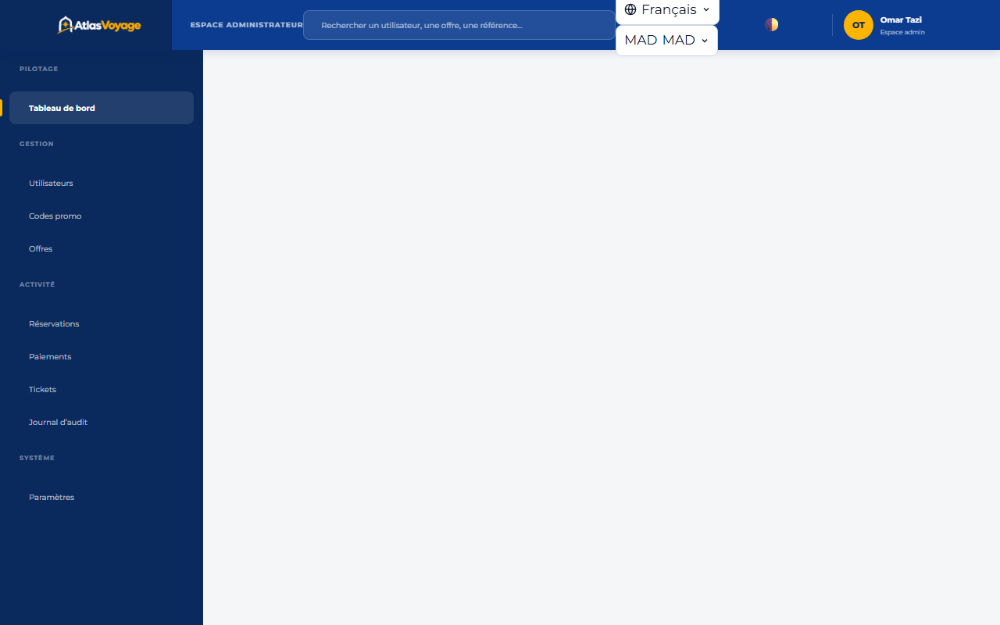

# Manuel Utilisateur — Espace Administrateur

> **Statut :** ✅ Implémenté  
> **Date de mise à jour :** 2026-11-01  
> **Profil :** Superviseur & Administrateur Global (`ROLE_ADMIN`)  
> **Point d'entrée :** `http://127.0.0.1:5500/frontend/admin/index.html`

---

## 1. Vue d'Ensemble & Supervision Globale

Le tableau de bord administrateur consolide l'activité de l'ensemble de la plateforme :

- Volume d'utilisateurs actifs par rôle (`CLIENT`, `SUPPLIER`, `AGENT`, `ADMIN`).
- File des offres touristiques soumises en attente d'approbation.
- Chiffre d'affaires global de la plateforme, commissions prélevées et volume d'annulations.
- Accès direct au journal des alertes de sécurité.

---

## 2. Gestion des Utilisateurs & Déverrouillage de Compte

Dans l'onglet **« Utilisateurs »** :
- **Recherche & Filtrage :** Filtrez par rôle, statut de compte (`ACTIVE`, `ARCHIVED`, `LOCKED`) ou adresse email.
- **Création d'agents et administrateurs :** Provisionnez de nouveaux collaborateurs avec affectation stricte des privilèges.
- **Déverrouillage anti-brute-force :** Si un utilisateur est bloqué suite à 5 tentatives de mot de passe infructueuses, cliquez sur le bouton **« Déverrouiller le compte »** pour réinitialiser son compteur immédiatement.

---

## 3. Modération des Offres & Avis Clients

- **Offres en attente (`PENDING`) :** Vérifiez l'adéquation des tarifs, la qualité des photos et la cohérence des disponibilités avant validation (`APPROVED`) ou rejet avec motif explicatif (`REJECTED`).
- **Avis signalés par la communauté :** Lorsqu'un commentaire est jugé déplacé ou injurieux, arbitrez la publication ou la censure de l'avis. Chaque action de modération est consignée dans l'audit.

---

## 4. Journal d'Audit Immuable (Audit Log)

Le journal d'audit enregistre de façon irréversible (*append-only*) toute action sensible réalisée sur la plateforme :
- Authentifications, échecs répétés et verrouillages.
- Modifications de tarifs ou de statuts d'offres.
- Remboursements bancaires partiels ou totaux.
- Changements de paramètres système.
- **Export CSV sécurisé :** Téléchargez l'historique complet pour transmission aux commissaires aux comptes ou auditeurs de sécurité.

---

## 5. Paramètres Système & Mode Maintenance

- **Taux de commission plateforme :** Définissez le pourcentage prélevé sur les ventes des fournisseurs partenaires.
- **Coordonnées officielles :** Email de contact, téléphone du support et mentions légales affichées sur le site public.
- **Mode Maintenance :** En cas d'intervention technique programmée, activez le mode maintenance en 1 clic : les utilisateurs reçoivent poliment un écran explicatif tout en conservant l'accès d'administration.
