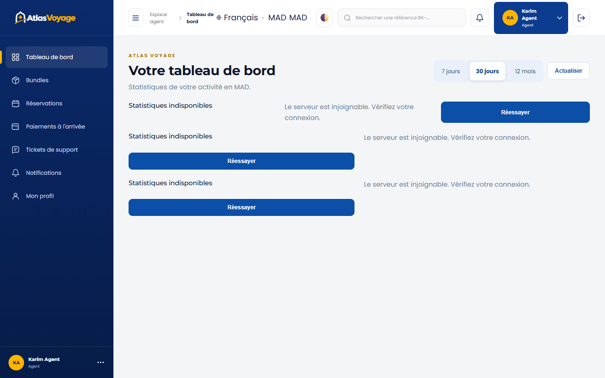
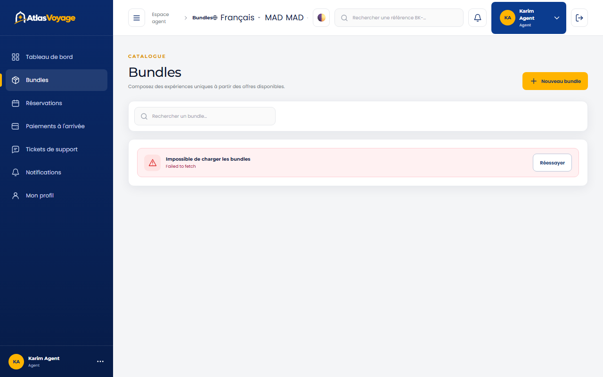
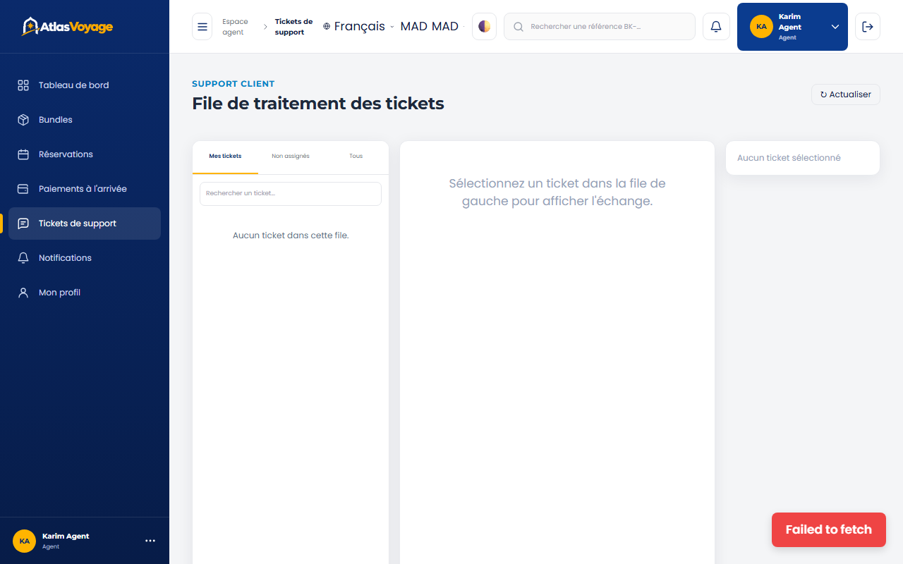

# Manuel Utilisateur — Espace Agent de Voyage

> **Statut :** ✅ Implémenté  
> **Date de mise à jour :** 2026-11-10  
> **Profil :** Conseiller Commercial & Gestionnaire Guichet (`ROLE_AGENT`)  
> **Point d'entrée :** `http://127.0.0.1:5500/frontend/agent/index.html`

---

## 1. Rôle & Missions de l'Agent

L'agent de voyage est le pivot opérationnel d'Atlas Voyage en agence physique ou support client centralisé :
1. **Encaissement des paiements en espèces au guichet.**
2. **Création et commercialisation de packages touristiques (Bundles combinés).**
3. **Assistance clientèle de niveau 1 & 2 via la billetterie de support.**

---

## 2. Encaissement des Paiements en Espèces (Cash Payment)

Lorsqu'un voyageur se présente en agence avec une réservation en attente de paiement à l'arrivée :
1. Ouvrez **« Paiements à l'arrivée »** dans le menu latéral (onglet **« À encaisser »**).
2. Recherchez le dossier par **nom du client** ou **référence de réservation** (`BK-AAAA-NNNNNN`).
3. Vérifiez le montant exact dû en Dirhams Marocains (MAD TTC).
4. Cliquez sur **« Encaisser le règlement »** :
   - Le système valide instantanément la transaction (`PAID`).
   - Le statut de la réservation bascule en `CONFIRMED`.
   - Le reçu d'encaissement et le voucher définitif sont envoyés au client par notification.

---

## 3. Composition de Packages Touristiques (Bundles)

Pour composer une offre promotionnelle clé en main (ex. « Pack Escapade Marrakech : Riad de Charme + Vol AR + Excursion Ourika ») :
1. Cliquez sur **« Créer un Bundle »**.
2. Sélectionnez au moins deux offres validées de fournisseurs différents.
3. Définissez le pourcentage de réduction consenti sur l'ensemble.
4. Le système calcule automatiquement le prix remisé et ajuste le stock dynamique selon la capacité minimale des offres composantes.

---

## 4. Support Client & Traitement des Réclamations

- Accédez à la file d'attente des tickets clients classés par priorité.
- Répondez aux sollicitations, modifiez les dates de réservation si nécessaire ou escaladez le dossier à un administrateur en cas de litige financier.

---

## 5. Navigation & Compte

- **Menu latéral « ESPACE AGENT »** : Tableau de bord, Bundles, Réservations, Paiements à l'arrivée, Tickets de support, Mon profil.
- **En-tête** : sélecteur de devise, cloche des notifications (« Voir toutes les notifications » ouvre la page complète) et nom de l'agent. Un clic sur le nom ouvre un menu de raccourcis (Tableau de bord, Réservations, Paiements à l'arrivée, Tickets de support, Mon profil) qui se termine par **« Déconnexion »**.
- **Réservations** : recherche par référence ou nom du client, filtres de statut, de dates et de paiement. La fiche (« Voir ») résume la réservation ; l'encaissement se fait depuis « Paiements à l'arrivée ».
- **Tickets** : dans la file, une note interne est repérée par le libellé « Note interne » ; elle n'est jamais visible du demandeur.
