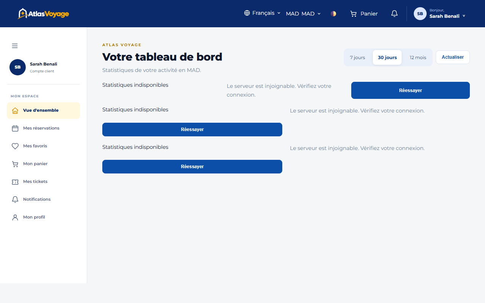
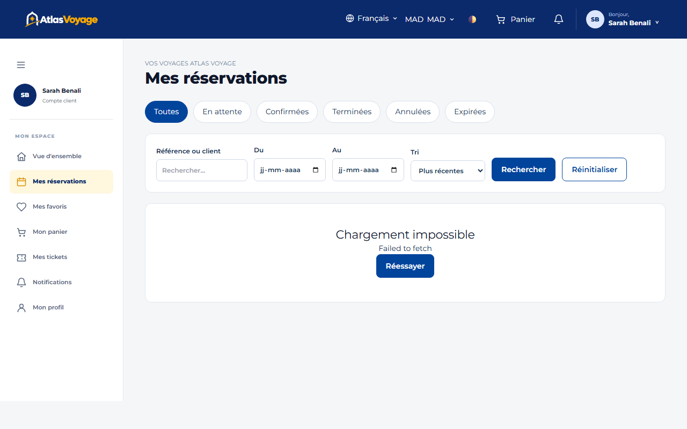
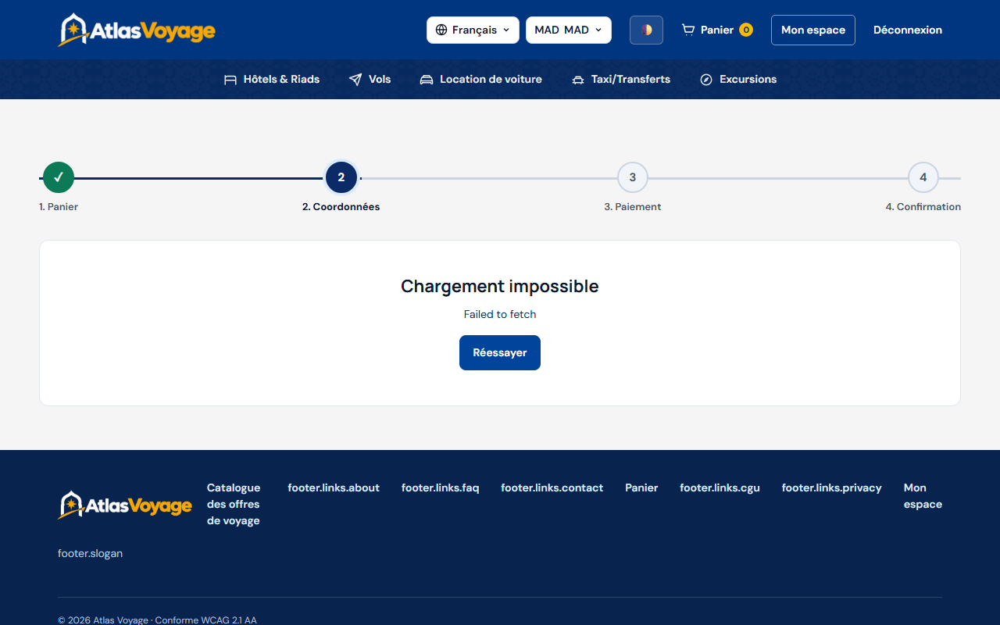
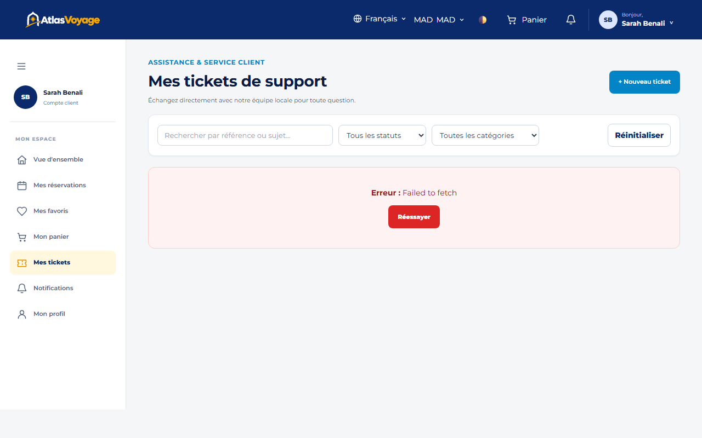

# Manuel Utilisateur — Espace Client

> **Statut :** ✅ Implémenté  
> **Date de mise à jour :** 2026-11-01  
> **Profil :** Voyageur particulier (`ROLE_CLIENT`)  
> **Point d'entrée :** `http://127.0.0.1:5500/frontend/client/index.html`

---

## 1. Tableau de Bord Client

Dès votre connexion, votre espace client vous présente une vue synthétique de vos projets de voyage :

- **Indicateurs clés :** Nombre de réservations à venir, séjours terminés, solde des devis et points d'attention.
- **Raccourcis rapides :** Accès direct au catalogue, à vos vouchers PDF et à vos tickets de support.
- **Cloche de notifications :** Alertes de confirmation de commande, rappels de séjour à J-3 et réponses du support client.

---

## 2. Gestion des Réservations & Bons d'Échange (Vouchers)

Dans l'onglet **« Mes Réservations »** :
1. **Détail de la commande :** Référence unique (`BK-AAAA-NNNNNN`), liste des prestations, dates exactes et statut financier.
2. **Téléchargement du Voucher PDF :** Cliquez sur l'icône Document pour générer votre bon d'échange officiel avec QR code signé cryptographiquement. À présenter au fournisseur lors de votre arrivée.
3. **Annulation en ligne :**
   - **> 48 heures avant le début :** Annulation gratuite avec remboursement intégral automatique.
   - **Entre 24h et 48h :** Indemnité forfaitaire de 50%, remboursement du solde.
   - **< 24 heures :** Aucun remboursement (frais de 100%).

---

## 3. Tunnel de Commande en 4 Étapes

Le tunnel interactif sécurisé (`av-stepper`) guide la finalisation :
1. **Étape 1 - Panier :** Récapitulatif des articles, ajustement des quantités et application d'un code promotionnel éventuel.
2. **Étape 2 - Coordonnées :** Vérification des informations des voyageurs et contact d'urgence.
3. **Étape 3 - Options :** Sélection du mode de règlement (Carte bancaire immédiate ou Espèces en agence / Paiement à l'arrivée si autorisé par les prestataires).
4. **Étape 4 - Règlement sécurisé :** Paiement en ligne simulé (environnement de démonstration Sandbox sans débit bancaire réel).

---

## 4. Billetterie de Support (SAV)

En cas de question ou de demande de modification sur un voyage :
- Cliquez sur **« Nouveau ticket »**, renseignez le sujet, la catégorie (Réservation, Paiement, Réclamation) et le message.
- Échangez directement avec les conseillers Atlas Voyage au sein d'un fil de discussion persistant et horodaté.
- Recevez une notification instantanée dès qu'un agent ou administrateur vous répond.

---

## 5. Profil, Sécurité & Droits RGPD

Dans l'onglet **« Mon Compte »** :
- **Préférences régionales :** Choisissez votre langue préférée (FR, EN, AR) et devise par défaut.
- **Sécurité :** Changement de mot de passe renforcé (12 caractères minimum, 3 classes).
- **Protection des données (Loi 09-08 / RGPD) :**
  - **Exportation des données :** Téléchargez une copie intégrale au format JSON de toutes vos informations enregistrées.
  - **Suppression du compte :** Demandez l'anonymisation irréversible et la suppression de votre compte conformément à la loi.
