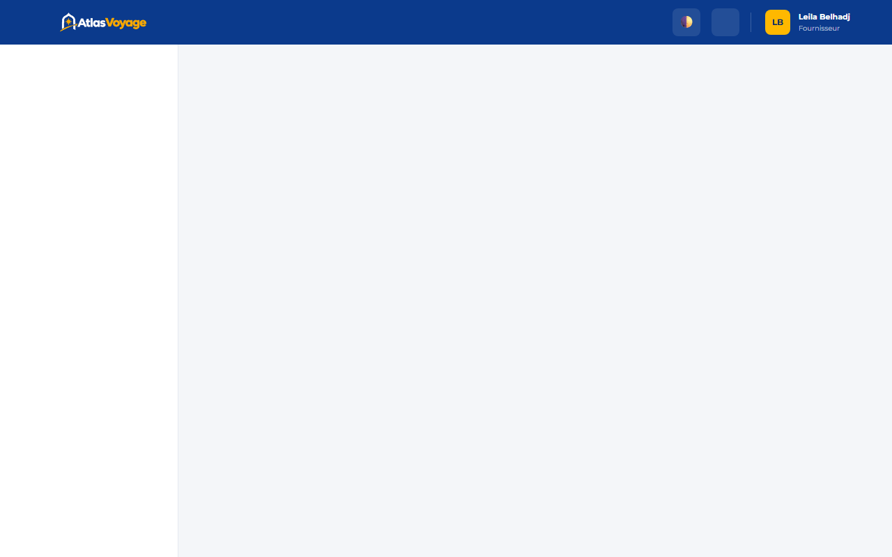

# Manuel Utilisateur — Espace Fournisseur

> **Statut :** ✅ Implémenté  
> **Date de mise à jour :** 2026-11-01  
> **Profil :** Prestataire Touristique Spécialisé (`ROLE_SUPPLIER`)  
> **Point d'entrée :** `http://127.0.0.1:5500/frontend/supplier/index.html`

---

## 1. Spécialisation Métier & Tableau de Bord

Chaque fournisseur est rattaché à une catégorie exclusive déterminée lors de son inscription :
- **HÔTELS & RIADS :** Hébergements touristiques, chambres d'hôtes.
- **VOLS :** Liaisons aériennes intérieures et internationales.
- **VOITURES :** Flottes de location de véhicules.
- **TAXIS / TRANSFERTS :** Navettes privées et transferts aéroports.
- **EXCURSIONS / ACTIVITÉS :** Randonnées, circuits guidés, sports et bien-être.

Le tableau de bord présente en temps réel :
- Le nombre total d'offres en ligne et en attente de modération.
- Le taux d'occupation et les réservations récentes associées à vos prestations.
- Les alertes de stock faible lorsque la capacité disponible passe sous le seuil critique.

---

## 2. Création d'Offre — Le Wizard en 4 Étapes

Pour publier une nouvelle prestation, cliquez sur **« Déposer une offre »** :
1. **Étape 1 - Informations Générales & Traductions :**
   - Titre, description détaillée et ville d'exécution.
   - Saisie multilingue optionnelle (Français, Anglais, Arabe) via les onglets dédiés.
2. **Étape 2 - Tarification & Attributs Spécifiques :**
   - Prix de base en MAD TTC.
   - Attributs selon spécialité : nombre d'étoiles et type de chambre (Hôtel), aéroport et compagnie (Vol), catégorie de véhicule et carburant (Voiture), itinéraire (Taxi), durée et niveau de difficulté (Excursion).
3. **Étape 3 - Galerie Photos & Médias :**
   - Téléversement d'images haute définition (max 5 Mo par photo).
4. **Étape 4 - Périodes de Disponibilité :**
   - Définition des plages de dates (ex. du 01/12 au 15/12) et de la capacité maximale réservable par créneau.

> [!NOTE]
> Une fois soumise, l'offre passe au statut `PENDING` pour validation administrative. Vous êtes notifié dès sa mise en ligne.

---

## 3. Gestion des Disponibilités & Calendrier

- Visualisez les périodes actives pour chacune de vos prestations.
- Ajustez les capacités restantes ou bloquez exceptionnellement des dates en cas d'indisponibilité.
- Le système garantit l'absence totale de surréservation (overbooking) grâce à son verrouillage transactionnel strict.

---

## 4. Statistiques de Ventes & Réponse aux Avis

- **Indicateurs financiers :** Chiffre d'affaires généré en MAD, volume de nuitées/places vendues, panier moyen.
- **Gestion de la réputation :** Consultez les notes et commentaires déposés par les clients ayant séjourné chez vous.
- **Droit de réponse :** Déposez une réponse officielle visible publiquement sous l'avis client.
