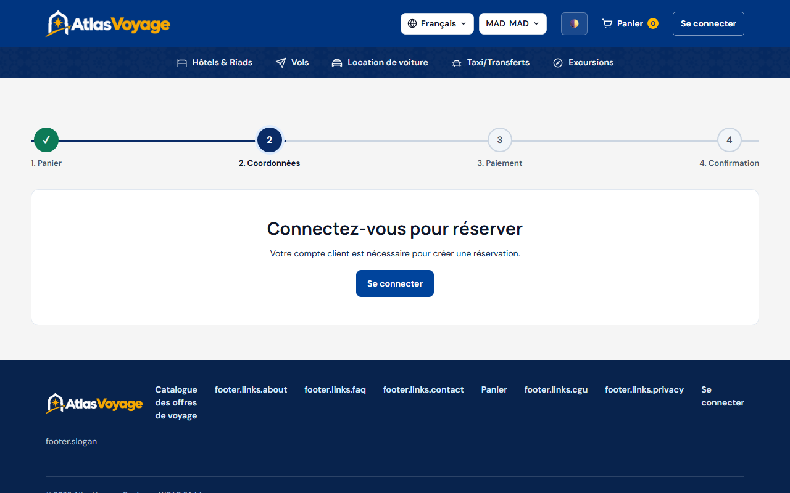

# Guide Utilisateur — Visiteur & Invité

> **Statut :** ✅ Implémenté  
> **Date de mise à jour :** 2026-11-01  
> **Profil :** Visiteur non authentifié (Grand Public)  
> **Point d'entrée :** `http://127.0.0.1:5500/frontend/accueil.html`

---

## 1. Parcours de Découverte

En tant que visiteur d'Atlas Voyage, vous pouvez explorer librement l'intégralité du catalogue touristique marocain sans obligation de créer un compte préalable.

### Actions Principales depuis l'Accueil :
1. **Recherche rapide :** Sélectionnez votre destination (Marrakech, Agadir, Fès, Tanger, Casablanca...), votre type de séjour et vos dates de voyage.
2. **Sélecteur de langue & devise :** En haut à droite, basculez entre Français (`FR`), Anglais (`EN`) ou Arabe (`AR` avec affichage RTL) et choisissez votre devise indicative de consultation (MAD, EUR, USD, GBP).
3. **Thème d'affichage :** Activez le mode sombre (icône Lune) ou clair selon votre confort visuel.

---

## 2. Exploration du Catalogue & Filtres

Le catalogue regroupe l'ensemble des offres publiées et validées par les modérateurs :
- **Filtres par catégorie :** Hôtels & Riads, Vols, Locations de Voitures, Taxis & Transferts, Excursions.
- **Filtres par facettes :** Fourchette de prix en MAD, note moyenne minimale (étoiles), ville ou aéroport de départ.
- **Tri dynamique :** Par popularité, prix croissant, prix décroissant ou note des voyageurs.

---

## 3. Consultation d'une Offre & Disponibilités

Sur la fiche détaillée de la prestation :
1. **Galerie photos & Lightbox :** Cliquez sur les images pour ouvrir la visionneuse plein écran avec zoom et défilement clavier/tactile.
2. **Carte interactive (Leaflet) :** Localisez précisément l'hôtel ou le point de départ de l'excursion.
3. **Sélection de période :** Le calendrier interactif affiche uniquement les dates disposant d'une capacité disponible.
4. **Ajout au panier :** Choisissez le nombre de personnes et cliquez sur **« Ajouter au panier »**.

---

## 4. Panier & Connexion

Le panier conserve vos articles sélectionnés. Pour valider votre commande et procéder au paiement ou à la réservation avec paiement sur place, la plateforme vous invite à vous connecter ou à créer votre compte en 1 minute.

