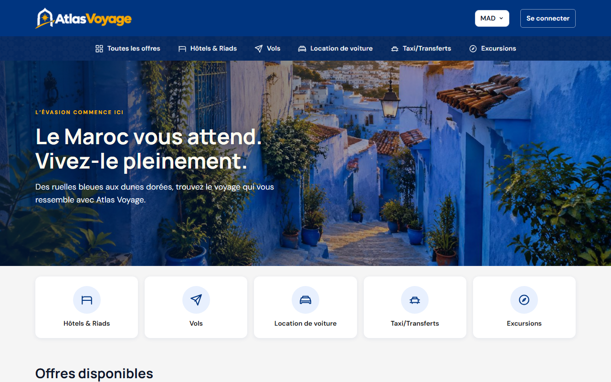
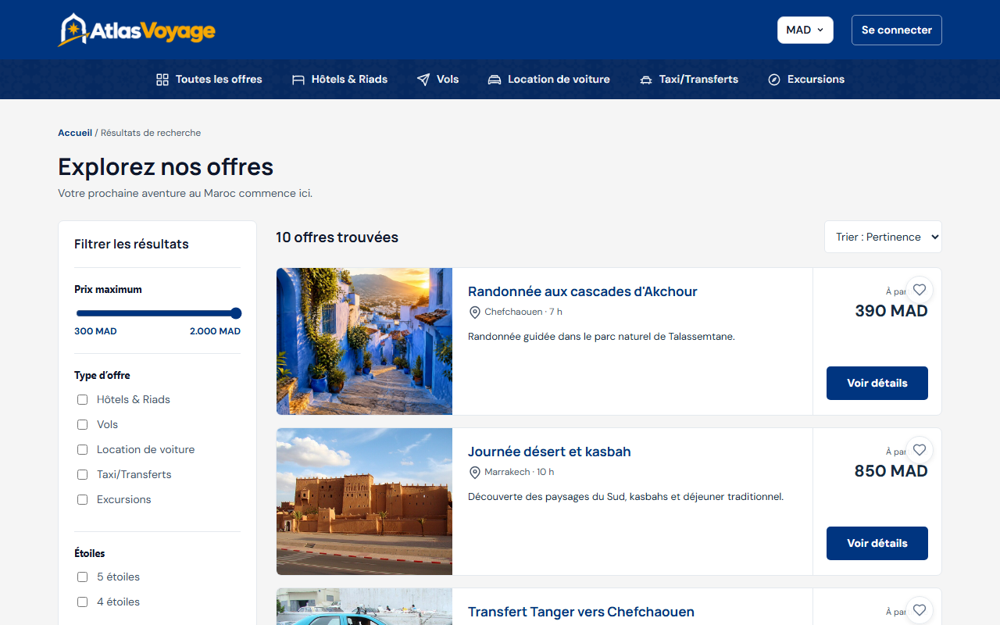
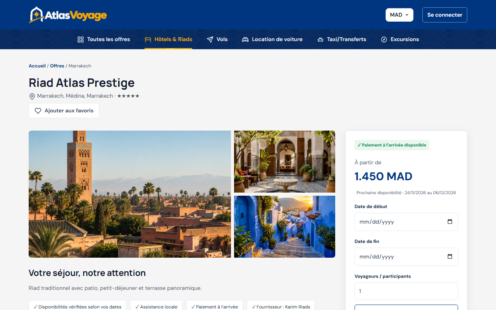
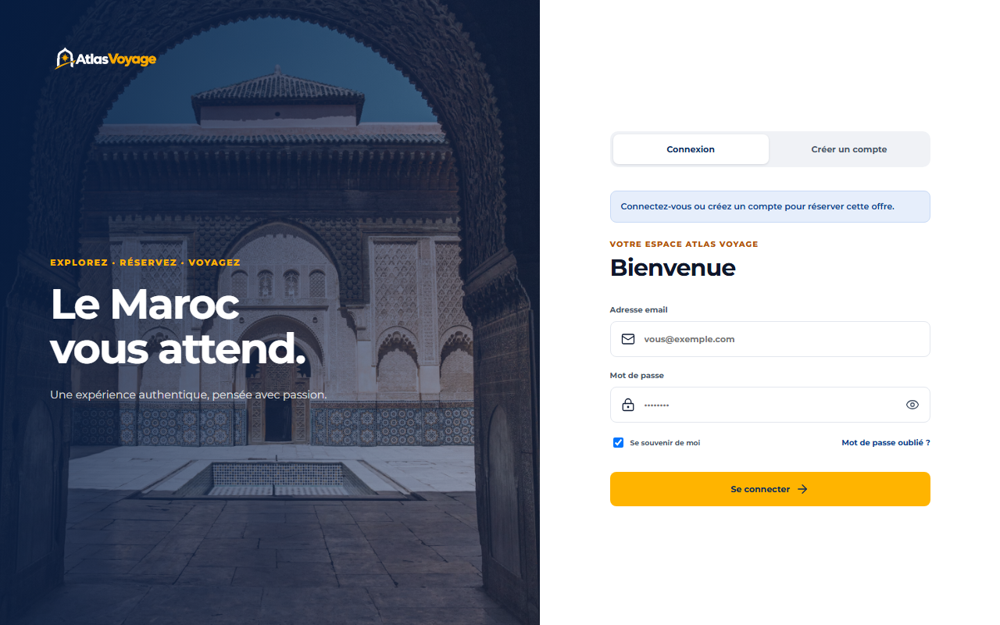
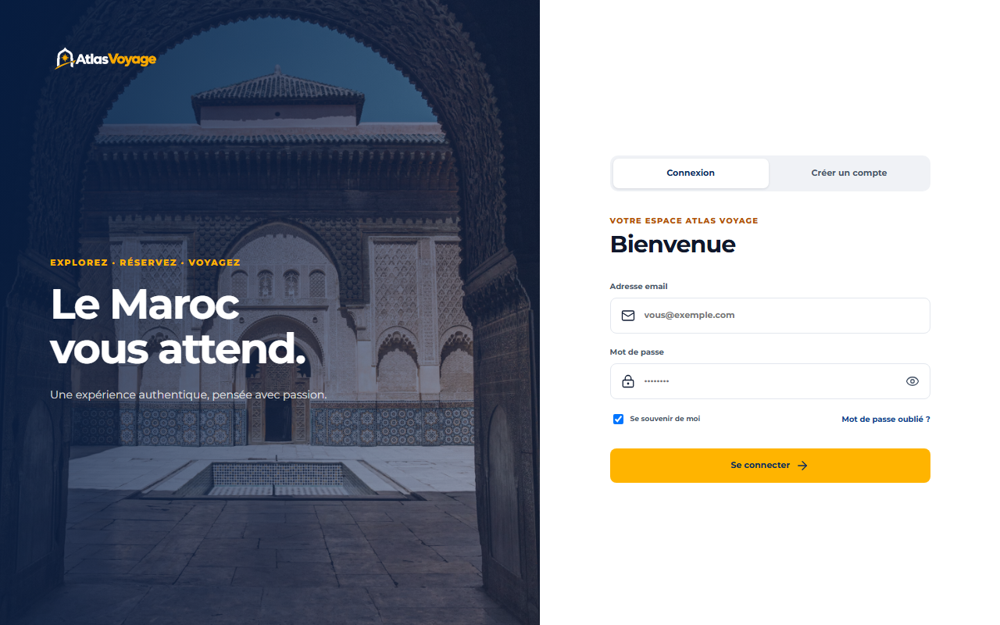
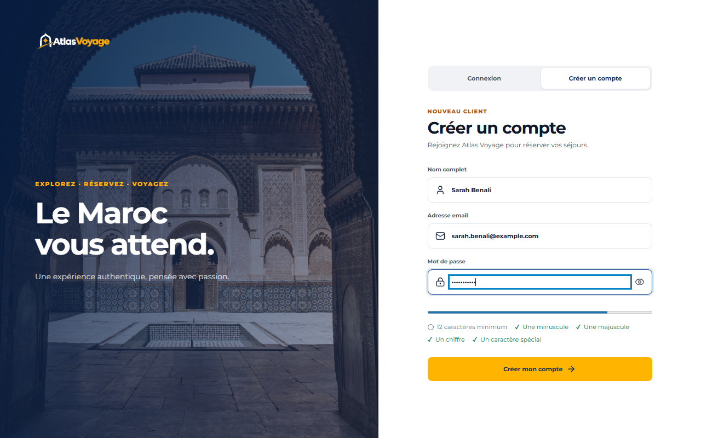

# Guide Utilisateur — Visiteur & Invité

> **Statut :** ✅ Implémenté  
> **Date de mise à jour :** 2026-11-09  
> **Profil :** Visiteur non authentifié (Grand Public)  
> **Point d'entrée :** `http://127.0.0.1:5500/frontend/accueil.html`

---

## 1. Parcours de Découverte

En tant que visiteur d'Atlas Voyage, vous pouvez explorer librement l'intégralité du catalogue touristique marocain sans créer de compte. Un compte client n'est nécessaire qu'au moment de réserver (voir §4).

### Ce que propose l'accueil :
1. **Barre de navigation :** « Toutes les offres » ouvre le catalogue complet (toutes les offres, avec les filtres de prix, de type, d'étoiles et de ville) ; Hôtels & Riads, Vols, Location de voiture, Taxi/Transferts et Excursions ouvrent le catalogue filtré sur la catégorie choisie.
2. **Cartes de catégories :** les mêmes catégories sous forme de grandes cartes, juste sous l'image d'accueil.
3. **Offres disponibles :** un aperçu des offres actives pour les hôtels et riads, les vols, les locations de voiture et les taxis/transferts, avec un lien « Voir toutes les offres » vers le catalogue.
4. **Sélecteur de devise :** en haut à droite, choisissez la devise d'affichage indicative (MAD, EUR, USD ou GBP). Le paiement reste toujours en dirhams (MAD).
5. **Connexion :** le bouton « Se connecter » donne accès à votre compte ; une fois connecté, il devient le raccourci vers votre espace.

Le pied de page se limite au logo et au lien de connexion.

> **À savoir :** l'interface est actuellement affichée en **français** et en **thème clair** uniquement. Le moteur de traduction (FR / EN / AR avec affichage de droite à gauche) et le thème sombre existent dans le code mais sont désactivés (`detectInitialLang` dans `frontend/js/shared/i18n.js`, `frontend/js/shared/theme.js`) : aucun sélecteur de langue ni bouton de thème n'est affiché aux visiteurs.

---

## 2. Exploration du Catalogue & Filtres

Le catalogue regroupe l'ensemble des offres publiées et validées par les modérateurs :
- **Filtres par catégorie :** Hôtels & Riads, Vols, Locations de Voitures, Taxis & Transferts, Excursions.
- **Filtres par facettes :** Fourchette de prix en MAD, note moyenne minimale (étoiles), ville ou aéroport de départ.
- **Tri dynamique :** Par popularité, prix croissant, prix décroissant ou note des voyageurs.

---

## 3. Consultation d'une Offre & Disponibilités

Sur la fiche détaillée de la prestation :
1. **Galerie photos & Lightbox :** Cliquez sur les images pour ouvrir la visionneuse plein écran avec zoom et défilement clavier/tactile.
2. **Carte interactive (Leaflet) :** Localisez précisément l'hôtel ou le point de départ de l'excursion.
3. **Disponibilités :** La fiche indique la prochaine période disponible ; seules les dates disposant d'une capacité sont réservables.
4. **Réserver :** Choisissez vos dates et le nombre de voyageurs, puis cliquez sur **« Ajouter au panier »** ou **« Réserver maintenant »**. Ces deux actions sont **réservées aux comptes clients** : en tant que visiteur, vous êtes dirigé vers la page de connexion (voir §4).

---

## 4. Réserver : se connecter ou créer un compte

Il n'existe **pas de panier pour les visiteurs** : le lien « Panier » n'apparaît dans l'en-tête qu'une fois connecté avec un compte client.

Lorsque vous cliquez sur « Ajouter au panier » ou « Réserver maintenant » sans être connecté, la plateforme vous envoie vers la page de connexion avec le message « Connectez-vous ou créez un compte pour réserver cette offre ».

Une fois connecté (ou votre compte créé), vous êtes **ramené sur la même offre**, avec les dates et le nombre de voyageurs que vous aviez saisis, et vous pouvez alors l'ajouter à votre panier.

### Page de connexion

- **Se souvenir de moi** (cochée par défaut) : votre session est conservée **7 jours** (durée par défaut, paramétrable côté serveur), y compris après la fermeture du navigateur. Décochée, la session n'est pas conservée : elle prend fin à la fermeture du navigateur, et l'interface vous déconnecte dès la fermeture de l'onglet. À décocher sur un ordinateur partagé.
- **Mot de passe oublié ?** : ce lien, placé à droite de « Se souvenir de moi », mène à la demande de réinitialisation du mot de passe, envoyée par e-mail.
- Après cinq échecs de connexion consécutifs, le compte est verrouillé temporairement.

---

## 5. Créer un compte

L'onglet **« Créer un compte »** demande votre nom complet, votre adresse e-mail et un mot de passe. Aucune case à cocher n'est demandée à l'inscription.

Le mot de passe doit respecter les règles suivantes :
- **12 caractères minimum** ;
- au moins **une minuscule**, **une majuscule**, **un chiffre** et **un caractère spécial**.

Une aide apparaît dès que vous cliquez dans le champ : la barre se remplit et chaque règle passe au vert (✓) quand elle est respectée. Trois autres règles ne s'affichent que si elles sont enfreintes, en rouge sous la liste : le mot de passe ne doit pas contenir votre adresse e-mail, ne doit pas être un mot de passe courant, et ne doit pas dépasser 72 octets.

Le bouton « Créer mon compte » vous connecte immédiatement : vous arrivez dans votre espace client, ou sur l'offre que vous consultiez si vous veniez de la page d'une offre.
