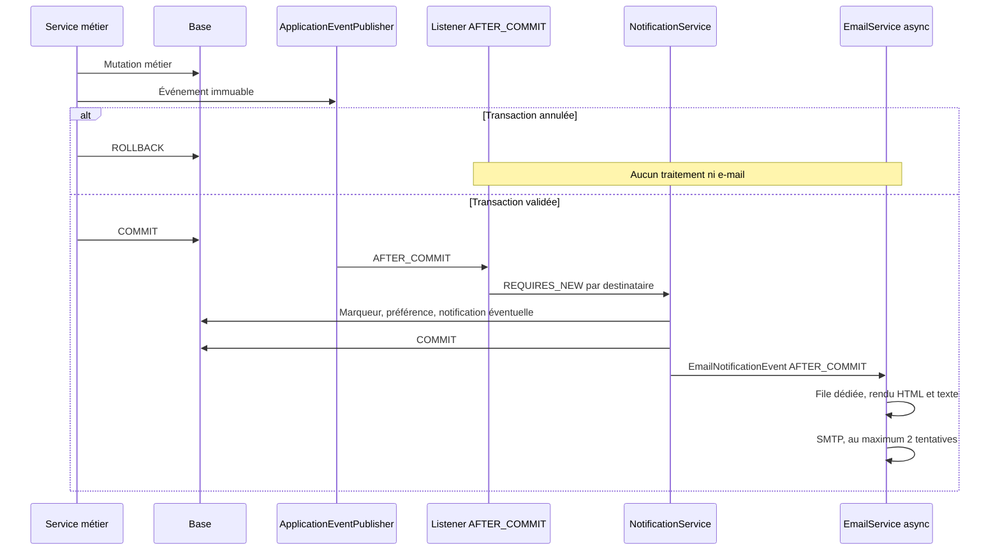

# Notifications — Phase 4

État au 31 octobre 2026. **66 endpoints au total, 7 routes Notifications**.
La base de départ était la Phase 3 : 59 endpoints, 190 tests, Booking et Payment
déjà implémentés. La présente phase ajoute 32 tests, soit **222 tests**.
Le module Ticket n'existe pas encore : seul son événement est préparé et testé.

## Modèle de données

### Notification

Table notifications, enrichie sans suppression par V8__notifications.sql :

| Champ | Règle |
|---|---|
| id | Identifiant technique |
| user | ManyToOne LAZY obligatoire ; propriétaire unique |
| type | NotificationType non nul ; catégorie déduite de l'enum |
| title | 150 caractères maximum |
| message | 1000 caractères maximum |
| link | Facultatif, 500 caractères maximum, chemin interne validé |
| is_read | Boolean false initialement ; éviter le mot SQL réservé read |
| created_at | Date UTC issue du Clock injectable |
| read_at | Facultative, fixée au premier marquage lu |
| reference_type / reference_id | Référence simple à l'entité métier |
| dedup_key | Facultative, 200 caractères maximum |

Index(user_id,is_read,created_at), index(user_id,created_at),
unicité(user_id,dedup_key). Les valeurs nulles de dedup_key restent autorisées.

Les notifications de l'ancien modèle sont reprises en SYSTEM avec le titre
« Information Atlas Voyage » ; message, date et état lu sont préservés.
read_at prend created_at pour les anciens messages lus qui n'avaient pas cette date.
La FK utilisateur est reprise en ON DELETE CASCADE : une suppression définitive
autorisée du compte ne laisse pas de notifications orphelines.

### Préférences

Table séparée notification_preferences, clé user_id, afin de ne pas étendre
User pour chaque canal ou catégorie. Champs :
emailEnabled, inAppEnabled, bookingEmail, paymentEmail, offerEmail, supportEmail.
Tous valent true par défaut. GET utilise ces défauts sans créer de ligne ;
PUT crée ou actualise la préférence. Les exemples de développement disposent
d'une ligne explicite. Tous les booléens du PUT sont obligatoires.

emailEnabled et les catégories ne désactivent jamais les e-mails ACCOUNT.
La configuration globale app.mail.enabled=false empêche néanmoins tout envoi réel.
inAppEnabled=false empêche la création dans la cloche, même pour ACCOUNT.
Un compte archivé ne reçoit ni nouvelle notification ni e-mail.

### Déduplication indépendante des canaux

notification_dispatches contient user_id, dedup_key et created_at, avec unicité
utilisateur/clé. Ce marqueur est nécessaire lorsqu'un utilisateur désactive le
canal in-app : un doublon d'événement ne doit pas envoyer deux e-mails.

Le destinataire est verrouillé pendant cette courte transaction de création.
Le marqueur, la notification éventuelle et la décision d'e-mail sont atomiques.
La violation d'unicité est interceptée hors transaction et ignorée.
Les destinataires sont aussi dédupliqués par un ensemble avant distribution.

Les marqueurs restent conservés après suppression/purge des notifications :
une ancienne alerte ne réapparaît pas au scan suivant. Ils ne contiennent ni
corps d'e-mail, ni contenu métier détaillé, ni secret.

## Types et catégories

| Catégorie | Types |
|---|---|
| BOOKING | BOOKING_CREATED, BOOKING_CONFIRMED, BOOKING_CANCELLED |
| PAYMENT | PAYMENT_RECEIVED, PAYMENT_FAILED |
| OFFER | AVAILABILITY_LOW, AVAILABILITY_EXPIRED, OFFER_DEACTIVATED, OFFER_REACTIVATED |
| SUPPORT | TICKET_REPLY |
| ACCOUNT | ACCOUNT_WELCOME |
| SYSTEM | SYSTEM |

Aucun DTO n'expose une entité JPA. NotificationResponse :
id, type, category, title, message, link, read, createdAt, readAt.

## Événements et destinataires

Tous les événements sont des records immuables du package event. Ils portent
identifiants, chaînes, dates, montants et listes copiées, sans entité détachée.

| Événement | Destinataires |
|---|---|
| UserRegisteredEvent | Nouveau compte |
| BookingCreatedEvent | Client, fournisseurs présents, agents actifs |
| BookingConfirmedEvent | Client, fournisseurs présents |
| BookingCancelledEvent | Client, fournisseurs présents, agents actifs |
| PaymentReceivedEvent | Client, fournisseurs présents |
| PaymentFailedEvent | Client uniquement |
| OfferModerationChangedEvent | Fournisseur propriétaire uniquement |
| AvailabilityLowEvent | Fournisseur propriétaire uniquement |
| AvailabilityExpiredEvent | Fournisseur propriétaire uniquement |
| TicketRepliedEvent | Demandeur ; assigné si le demandeur répond ; auteur exclu |

ADMIN n'est pas ajouté implicitement aux événements des autres utilisateurs.
Un utilisateur présent pour plusieurs raisons ne reçoit qu'une notification.
Un fournisseur reçoit seulement ses titres, quantités, dates et montants ; les
offres d'autres fournisseurs et le montant global du panier ne figurent pas
dans son message. Les textes trop longs sont tronqués avant persistance.
L'auteur et le motif d'annulation sont inclus, avec un renvoi au paiement
pour connaître le remboursement effectivement enregistré.

### Producteurs réellement branchés

| Méthode existante | Événement |
|---|---|
| AuthService.register | UserRegisteredEvent, dans la transaction d'inscription |
| OfferService.moderate | OfferModerationChangedEvent, motif et propriétaire |
| BookingService.createFromCart | BookingCreatedEvent ; BookingConfirmedEvent si confirmé immédiatement |
| BookingService.confirm | BookingConfirmedEvent, sous les règles de paiement existantes |
| BookingService.cancel | BookingCancelledEvent, auteur connecté |
| BookingService.cancelAfterRefund | BookingCancelledEvent, admin ou système |
| PaymentLedger.change vers PAID | PaymentReceivedEvent, carte ou encaissement espèces |
| PaymentLedger.change vers FAILED | PaymentFailedEvent |
| PaymentTransactions.finishCharge / prepare cash | BookingConfirmedEvent après confirmation effective |
| PaymentWebhookService.process succeeded | BookingConfirmedEvent après confirmation effective |
| AvailabilityAlertService.scan | AvailabilityLowEvent et AvailabilityExpiredEvent |

Le statut Payment reste la source comptable ; les notifications n'altèrent ni
Booking, ni Payment, ni prix, ni capacités. Une annulation après remboursement
n'est notifiée qu'une fois, même si plusieurs voies mènent au même état.
Une réservation impayée expirée suit le traitement Booking/Payment existant ;
aucun nouveau type d'événement d'expiration Booking n'a été inventé.

### Transaction et traitement e-mail



NotificationService utilise explicitement TransactionTemplate en REQUIRES_NEW,
afin que notifyMany et les appels après commit ne dépendent pas d'une
auto-invocation de méthode annotée. Chaque destinataire est isolé. Les exceptions
de livraison sont capturées, journalisées et ne remontent pas à l'opération métier.
L'envoi n'a lieu qu'après validation de cette seconde transaction.

Le publieur léger NotificationEvents utilise ApplicationEventPublisher. AuthService
et OfferService dépendent directement de cette infrastructure Spring pour rester
compatibles avec les contextes @DataJpaTest historiques qui importent ces services.
Les autres services réutilisent le composant partagé pour produire les snapshots.

### Futur module Ticket : branchement exact

Aucun TicketController ou TicketService n'a été créé. Le futur service de réponse
publiera l'événement **dans sa méthode transactionnelle, après sauvegarde du message** :

```java
publisher.publishEvent(new TicketRepliedEvent(
    "ticket:reply:" + savedReplyId,
    ticketId, ticketReference, requesterId, assignedAgentId,
    authorId, ticketSubject, replyPreview
));
```

eventId est stable et unique par réponse. assignedAgentId peut être null.
Ne jamais transmettre une entité JPA. Le listener existant applique l'exclusion
de l'auteur et des utilisateurs archivés, les préférences et la déduplication.
Les tests publient déjà cet événement pour une réponse agent et une réponse client.

Pour un futur producteur Booking/Payment supplémentaire, utiliser NotificationEvents
ou les records correspondants, avec une clé stable de transition. Les producteurs
actuels sont déjà branchés : aucune Phase 2/3 supplémentaire n'est requise.

## Alertes de disponibilité et purge

AvailabilityAlertScheduler :
- scan horaire par défaut, cron app.notifications.alert-cron ;
- purge à03:30, cron app.notifications.purge-cron, fuseau du serveur de planification ;
- désactivé avec app.scheduling.enabled=false, valeur du profil test.

Seules les offres actives et propriétaires non archivés sont parcourus, par lots
de100. La capacité initiale de référence est reconstruite :
capacité restante + somme des allocations non restituées.
Pas de nouveau stock, aucun changement du calcul commercial de capacité.

Alerte si capacité restante ≤2 OU ≤20 % de la référence. Clés :
availability:low:ID:CRITICAL pour le seuil absolu, LOW pour le pourcentage.
Un passage ultérieur à un palier plus critique peut générer une nouvelle alerte.
Le même palier ne se répète pas à chaque scan.

Pour la fin de période : alerte SOON quand endAt ≤ maintenant+3 jours,
alerte EXPIRED quand endAt < maintenant. Clé
availability:expiry:ID:SOON ou EXPIRED. Une période peut recevoir une alerte
d'anticipation puis une alerte de fin, jamais un nouvel exemplaire à chaque heure.

Purge : notifications lues dont createdAt est strictement antérieur à90 jours,
et toute notification strictement antérieure à180 jours. Les bornes exactes
restent conservées. Les marqueurs de déduplication ne sont pas purgés avec les messages.

## Configuration SMTP et variables

| Propriété | Variable / défaut |
|---|---|
| spring.mail.host | SMTP_HOST, localhost |
| spring.mail.port | SMTP_PORT, 1025 |
| spring.mail.username | SMTP_USERNAME, vide |
| spring.mail.password | SMTP_PASSWORD, vide |
| spring.mail.properties.mail.smtp.auth | SMTP_AUTH, false |
| spring.mail.properties.mail.smtp.starttls.enable | SMTP_STARTTLS, false |
| app.mail.from | MAIL_FROM, noreply@atlasvoyage.test |
| app.mail.enabled | MAIL_ENABLED, false |
| app.frontend.base-url | APP_BASE_URL, http://127.0.0.1:5500/frontend |
| app.scheduling.enabled | true, false en test |
| app.notifications.low-capacity-percent | 20 |
| app.notifications.low-capacity-units | 2 |
| app.notifications.expiry-warning-days | 3 |
| app.notifications.read-retention-days | 90 |
| app.notifications.retention-days | 180 |
| app.notifications.alert-cron | 0 0 * * * * |
| app.notifications.purge-cron | 0 30 3 * * * |

Délais SMTP de connexion/lecture/écriture :3000 ms. Aucune clé SMTP versionnée.
Spring ne charge pas automatiquement .env : exporter les variables ou utiliser l'IDE.
Les anciens app.mail.host/port/username/password, inutilisés, ont été remplacés
par les propriétés spring.mail.* réellement consommées par JavaMailSender.

Lorsque app.mail.enabled=false, aucun SMTP : seul le nom du modèle est journalisé.
Les logs ne contiennent ni destinataire, ni corps, ni mot de passe SMTP.
Deux tentatives maximum en cas d'échec ; l'exception ne casse jamais le métier.

Exécuteur notificationMailExecutor :2 threads, maximum 4, file500, arrêt propre.
Les messages sont multipart texte/HTML, UTF-8. Thymeleaf échappe les variables
dans les quatre modèles bienvenue, confirmation, annulation et reçu, plus un
modèle générique pour les autres informations. Le gabarit commun contient marque,
contenu et lien vers les préférences.

### Mailpit local

Mailpit a été utilisé réellement pour les vérifications, version 1.32.0.
Télécharger le binaire Windows depuis les
[versions officielles](https://github.com/axllent/mailpit/releases).
Le lancer avec accès local uniquement :

```powershell
.\\mailpit.exe --listen 127.0.0.1:8025 --smtp 127.0.0.1:1025
$env:MAIL_ENABLED="true"
$env:SMTP_HOST="localhost"
$env:SMTP_PORT="1025"
cd backend
.\\mvnw.cmd spring-boot:run
```

Ouvrir http://127.0.0.1:8025 : les messages restent capturés localement,
sans relais vers les véritables adresses. MailHog peut aussi servir sur 1025.

Références : [installation Mailpit](https://mailpit.axllent.org/docs/install/),
[SMTP](https://mailpit.axllent.org/docs/configuration/smtp/) et
[API de contrôle](https://mailpit.axllent.org/docs/api-v1/).

## API et sécurité

Les 7 routes sont décrites dans [api_endpoints.md](api_endpoints.md#notifications--phase-4-7-endpoints).
JWT obligatoire pour les 4 rôles. Aucun userId du navigateur n'est accepté.
Les requêtes de propriété contiennent WHERE id=:id AND user_id=:currentUserId.
Un message étranger est invisible :404, y compris pour ADMIN.

Les liens sont validés : pas de schéma, domaine externe, //, antislash,
traversée .., HTML ou espace. Les chemins absolus internes /... et les pages
Frontend connues sont acceptés. Le Frontend revalide l'origine et le chemin
avant navigation ; titres/messages passent uniquement par textContent.
Aucun endpoint public ne permet de publier un événement ou de créer une notification.

## Frontend

Module unique frontend/js/core/notifications.js et stylesheet notifications.css.
Les 4 espaces chargent le même module et remplacent leurs anciennes listes/compteurs.

- Cloche : compteur réel, masqué à0, 99+ au-delà, panneau des 10 derniers messages.
- Ouverture : lecture API ; compteur qui augmente → toast et panneau rafraîchi.
- Lecture au clic puis navigation vers le lien interne.
- Tout lire et lien vers la page complète.
- Échap ferme et redonne le focus ; flèches/HOME/END permettent de naviguer.
- Page paginée20 messages, filtres toutes/non lues/lues et catégories.
- Actions lire/supprimer/tout lire, états chargement/vide/erreur réessayable.
- Préférences persistées, dont canal in-app et catégories e-mail.
- Polling30 s,60 s si document masqué, promesse partagée pour empêcher les appels
  de compteur parallèles ; un seul timer réarmé après chaque appel.
- Nettoyage à la déconnexion, pagehide et remontage de l'en-tête client.
  Un401 emprunte Auth.logout et le mécanisme API existant.

Les paramètres?v=40 sont appliqués aux scripts de cette phase.
Aucune ligne de notification statique n'est conservée dans les interfaces.

## Démonstration, tests et limites opérationnelles

DataSeeder appelle NotificationDemoSeeder après utilisateurs/villes/offres.
Deux notifications par compte de démonstration (16 au total), une lue et une non lue,
dates échelonnées, clés fixes et préférences initiales. Aucun e-mail de démonstration
n'est envoyé par ce seeder. Les événements des exemples Booking/Payment nouveaux
peuvent, eux, produire des notifications cohérentes. Les scénarios déjà présents
ne sont pas rejoués au redémarrage.

222 tests réussis, dont 32 nouveaux. Les 190 précédents n'ont pas été modifiés.
Les contrôles HTTP et navigateur vivent dans scripts/phase 4_api_check.mjs et
scripts/phase 4_browser_check.mjs. Ils exigent une base isolée et
NOTIFICATION_ISOLATED_TEST=1 ; le test API vérifie réellement les corps
HTML/texte capturés dans Mailpit.

La livraison conserve le contrat demandé AFTER_COMMIT + file asynchrone :
ce n'est pas une outbox métier durable avec reprise après crash du processus.
Après2 échecs SMTP, le message est journalisé et n'est pas renvoyé automatiquement.
La cloche reste persistée et l'opération métier reste réussie. Une garantie
de livraison bancaire/production plus forte demanderait une file durable dédiée,
distincte du périmètre de cette phase.
